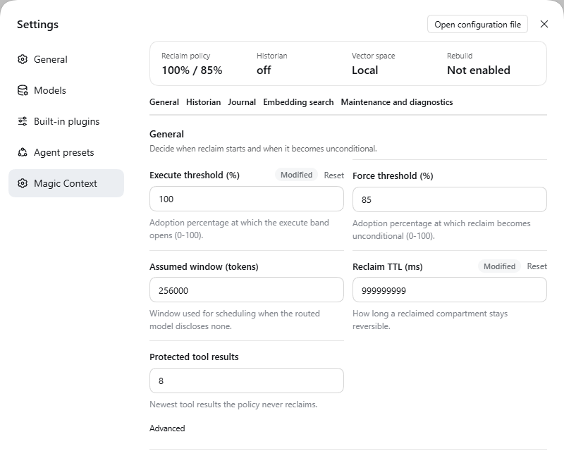
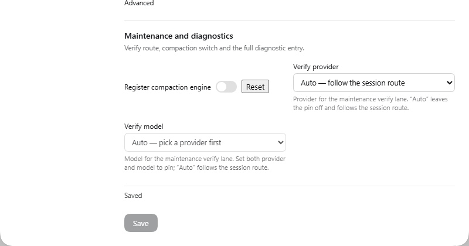
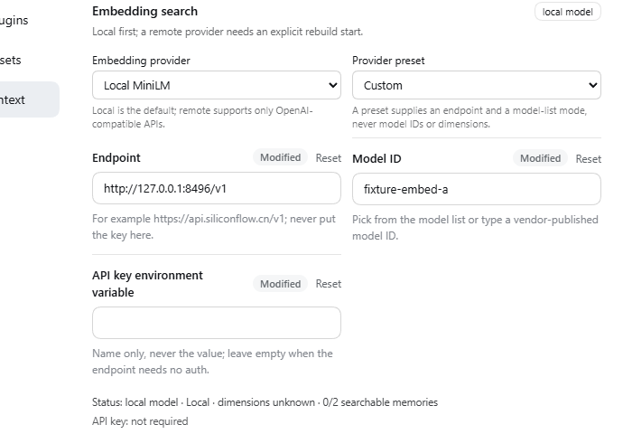
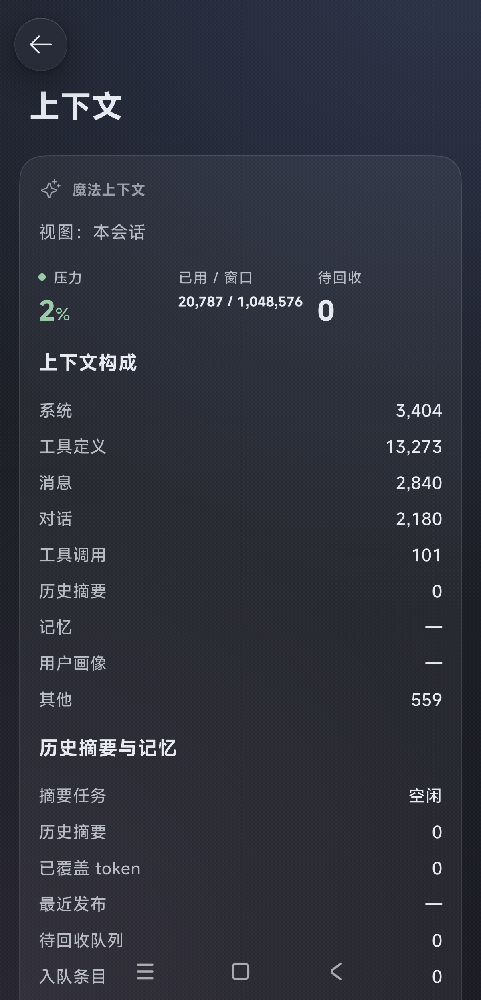
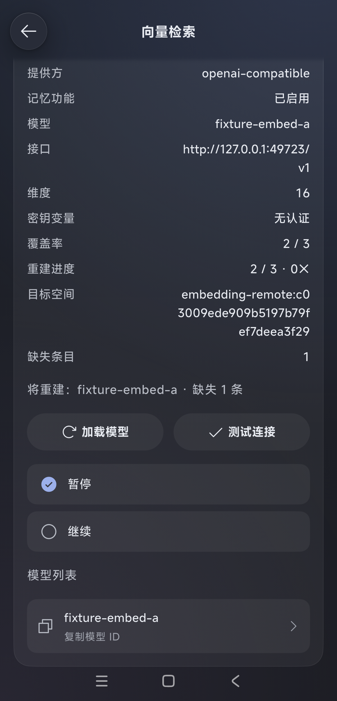
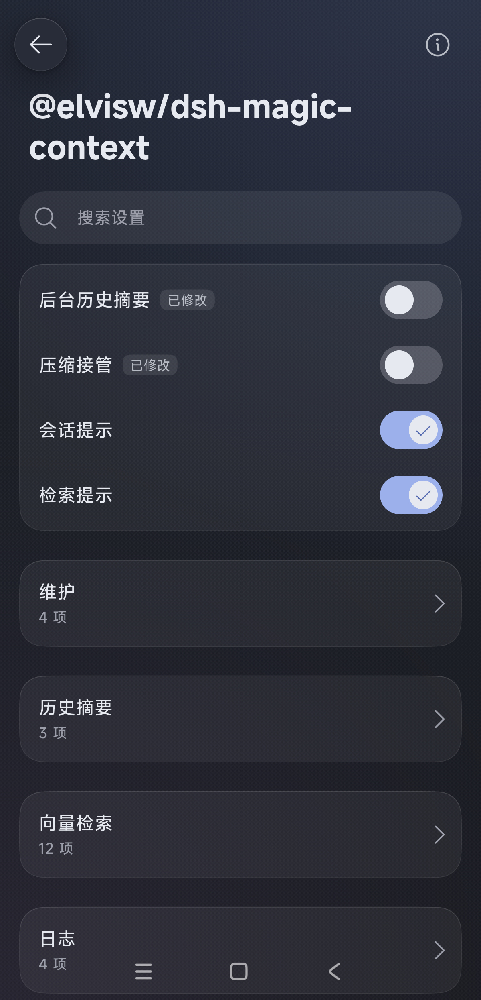

# Magic Context for DeepSeek Harness — elvisw fork

[](https://github.com/elvisw/dsh-plugin-magic-context/actions/workflows/ci.yml)
[](https://www.npmjs.com/package/@elvisw/dsh-magic-context)
[](https://github.com/elvisw/dsh-plugin-magic-context/blob/main/LICENSE)
[](https://github.com/elvisw/dsh-plugin-magic-context/blob/main/package.json)
[](https://github.com/elvisw/dsh-plugin-magic-context/blob/main/package.json)

> **English** | [简体中文](https://github.com/elvisw/dsh-plugin-magic-context/blob/main/README.zh-CN.md)

If you have run long sessions, you probably know these: details you worked out last session are gone this session, so you hit the same wall twice; the context window fills up with dozens of tool outputs; compaction invalidates the cache prefix and you pay for the expensive part all over again.

[Magic Context](https://github.com/cortexkit/magic-context) targets both problems. Knowledge should settle; context should be managed.

Facts distilled during a session become project memories that survive across sessions. Search combines keyword and local-vector retrieval. Sharing to other projects goes through a human approval step. On the context side, tool outputs can be tagged and reclaimed, and the original text can be pulled back later. History that has been digested becomes summaries instead of disappearing.

This plugin brings that to **DeepSeek Harness (DSH)**. It installs into a profile as a bundle and starts working inside the running app.

Upstream has been checked through v0.49.30. Verified on host 0.2.2-rc.1 and used daily in a Web profile. Repository history and provenance are in [NOTICE](https://github.com/elvisw/dsh-plugin-magic-context/blob/main/NOTICE).

## Install

You need Node ≥ 22.19 and a DSH 0.2.x host with a web client (desktop app or `web` profile).

```bash
dsh plugin --profile web add @elvisw/dsh-magic-context
```

The package ships its build output, so restart the profile and it works. Profiles with HMR hot-load it instead.

From 0.18.0 the same package also serves Android dsh-go 1.1.0 — see [Android](#android). No Flutter build, no second package.

> **Package name.** The unscoped `dsh-magic-context` on npm is a different implementation by another maintainer. It is neither this fork nor its upstream. This fork publishes only as `@elvisw/dsh-magic-context`, so the `@elvisw/` scope is required in every install command.

If you previously installed `@elvisw/dsh-plugin-magic-context` (0.12.x) or the upstream `dsh-plugin-magic-context`, remove the old package first. All three use the loader row id `magic-context-dsh`; installing more than one loads a single row and the settings page can disappear. Upgrading from 0.12.x also needs a one-time package-name migration in the profile patch — the script and steps are in [package identity and release](https://github.com/elvisw/dsh-plugin-magic-context/blob/main/docs/independent-package-release.md).

The optional compaction takeover only applies to flat/headless setups and **does nothing in Web or desktop**, explained in the [configuration reference](https://github.com/elvisw/dsh-plugin-magic-context/blob/main/docs/configuration.md).

## What you will see

- Tool results carry `§N§` tags. The overlay gains a telemetry badge showing live context usage; open it for the token breakdown and the activity log.
- Settings gains a top-level **Magic Context** page. The old Plugins-page card is gone, so a host without a `settings.section` slot has no configuration entry.
- Three tools are registered: `ctx_reduce`, `ctx_expand`, `ctx_memory`. Project memory is **on by default**, and facts distilled by the historian settle automatically.

A real reclaim looks like this:

```text
you:     ctx_reduce {"drop": "4-7"}
model:   queued 4 — landing as placeholders happens in the next reclaim band

... later ...
[dropped §4§] [dropped §5§] [dropped §6§] [dropped §7§]

you:     ctx_expand {"tag": "5"}
result:  §5's original text comes back as a new tool result; §5 stays dropped
```

## What it does

| Capability | What it means |
|---|---|
| **Project memory** | The plugin's own SQLite store, kept separate from upstream storage. Project identity is derived from the git root. The model reads and writes through `ctx_memory`. |
| **Local vector search** | MiniLM runs from WASM shipped in the package. No API key, no native compilation. Model files are hash-pinned and cached in the plugin data directory. Any failure falls back to keyword search. |
| **Memory baseline** | A frozen baseline plus incremental lanes. New memories never force a cache-prefix rebuild; unchanged content produces no change at all. |
| **Machine and work domains, user profile** | Staging can be automatic; **publishing always requires a person**. The profile's read, collect and review switches are independent. |
| **Maintenance tick** | Every 30 minutes: TTL archive, batch verification, vector backfill, domain candidate staging. |
| **Reversible reclaim** | Tool results are tagged. `ctx_reduce` only queues; landing happens in the next reclaim band. `ctx_expand` returns the original text as a new result. |
| **Pressure scheduling** | Pressure is computed from persisted usage with a 65% threshold and an 85% forced band. A window overflow triggers emergency reclaim and a retry. |
| **History summarisation** | The historian replays the real prefix (keeping the KV cache) and produces four summary layers plus facts. It writes to the store only, and publishing happens inside the execute band. |
| **Compaction seam** | Can take over the host's compaction engine, but only for flat/headless, and off by default. |
| **Settings page** | A sectioned top-level page: five sections and four summary rows. Copy switches between Chinese and English live. |
| **Telemetry panel** | Token breakdown bar, estimated message composition, and historian/memory/queue/maintenance sections. Values the host does not report show `—`, never 0. |

## Tools

Registered at mount time. `registerTools: false` turns them off.

| Tool | Purpose |
|---|---|
| `ctx_reduce` | Parses range syntax (`"3-5,8"`) and queues it. Landing costs a cache bust, so it waits for the reclaim band instead of firing on its own. |
| `ctx_expand` | Retrieves original text by `tag`, by `message` (a session log event seq), or by a `start`/`end` range. What comes back is a new tool result; the old placeholder and tag stay as they were. |
| `ctx_memory` | The memory read/write surface. Reads use `list` / `search` / `get`, writes use `write` / `update` / `archive` / `merge`. Also `review_global` for shared-domain approvals and `promote` for a single immediate nomination. Every action accepts `project` to work on another project. |

## Commands

`registerStatusCommand: false` turns off the whole command surface.

| Command | Purpose |
|---|---|
| `/ctx-status` | Pressure, decisions, reclaim ledger, compartments, baseline, policy |
| `/ctx-flush` | Marks already-queued reclaims to land on the next message. Starts no historian and makes no model call. |
| `/ctx-recomp` | Re-runs the historian and replaces stored summaries in place |
| `/ctx-wrapup` | Queues one manual compaction for the next pre-step, keeping the newest N entries (default 20) |
| `/ctx-profile` | Confirm, reject or retire user-profile candidates |
| `/ctx-global` | Domain membership and candidate approval |

Against cortexkit v0.49.59, `/ctx-dream` and `/ctx-embed` are not registered. The first needs the full dreamer task set; the second targets session history, memories and git commits while this adapter's vectors cover memories only. The per-command matrix is in [PARITY.md](https://github.com/elvisw/dsh-plugin-magic-context/blob/main/PARITY.md#command-surface-upstream-commands-checked-at-v04959).

## Settings

Under **Settings → Magic Context**: five sections, four summary rows, jump links and an advanced disclosure, with a plain-text status strip above the host footer. The old Plugins-page card has been removed.







The ones you are most likely to touch:

- **Memory switch.** On by default. To opt out, write `memory.enabled: false` in the profile patch.
- **Historian routing.** Pin provider and model, or leave both empty to follow the session. Reasoning effort comes from the host's model list.
- **Vector search.** Local MiniLM by default. To use an OpenAI-compatible embedding API (SiliconFlow, for example), pick the preset in this section, load the models and test the connection. The key is write-only, goes into the host credential store, and the card only reports configured or not.

The full key table with defaults is in the [configuration reference](https://github.com/elvisw/dsh-plugin-magic-context/blob/main/docs/configuration.md). When writing profile overrides by hand, note that `config` **replaces** the bundled config rather than merging into it.

### Telemetry badge

A pill above the composer. Collapsed it shows live pressure, the token pair, historian state and the reclaim queue (`H` / `Q<n>`); in a narrow window it shrinks to icons.

Opened, it shows:

- A **host token breakdown bar** split into system / tool definitions / messages, with the absolute token pair (`11.8k / 1M`).
- **Estimated message composition** split into conversation / tool calls / compacted spans / memories / user profile / other. Rows with no estimate are omitted rather than shown as 0.
- Sections for **historian, memory, reclaim queue, maintenance, reclaimable and warnings**.
- A **live activity log**, at most 12 rows, adjacent repeats folded into `×N`.

Focus stays inside the panel while open. Clicking outside, pressing Escape, losing window focus or hitting close all dismiss it and return focus to the pill. The footer links to `/ctx-status`.

## Android

The same npm package provides native panels for **Android dsh-go 1.1.0**. Choose the **on-device engine**.

Once the market entry is available, open **Plugin market → DSH Go adapter** and search for `@elvisw/dsh-magic-context`. If it is not there yet, install the exact version from the app's local terminal and restart the engine:

```bash
dsh plugin --profile web add @elvisw/dsh-magic-context@0.18.0
```

No Flutter changes, no second package. The host half registers the status strip and panels only when the bridge is present; desktop and Web profiles load as usual without it.

- **Composer status strip.** The same summary as the desktop pill, e.g. `context 62% · reclaim 3`. It yields to the host while a reply streams.
- **Context panel.** Opened from a conversation it strictly uses that `sessionId`; opened from All features it is labelled as a global view. Missing values show `—`, never 0. The phone does not recompute tokens.
- **Vector panel.** Shows provider, model, probed dimensions, coverage and rebuild progress. It can load model IDs, test the connection, start a rebuild after confirmation, and pause or resume. Opening the panel or saving config never probes or rebuilds on its own.





Remote embedding keys are entered in the desktop or Web settings page. The native settings page declares the same roles, but dsh-go 1.1.0's bridge does not yet pass the credential reference to the app, so the native key field is disabled — see [dsh-go issue #1493](https://github.com/ccch1mneyyy/dsh-Go/issues/1493). Until then, the phone works with local MiniLM and needs no key.

### How far the phone has been verified

On 2026-11-18 the full local-vector path was verified on the same phone with the **published 0.18.0 package**: three memories were backfilled by the maintenance tick into 384-dimension vectors, `ctx_memory action=search` returned `match=hybrid` for rows matched by both lanes and `match=semantic` for the row only the vector lane could reach, and after an engine restart the shared-space gate reported `parity: 1`. Details in the [T25 report](https://github.com/elvisw/dsh-plugin-magic-context/blob/main/_bmad-output/initiative-dsh-magic-context/acceptance-android-dsh-go-2026-11-18-t25-local-vector/acceptance-report.md).

The earlier T23 acceptance ran on a pre-release candidate and covered real memory writes and recall, native panels, configuration and recall after restart, using a 16-dimension simulated embedding service rather than SiliconFlow.

Not yet tested: the English phone UI, iOS, long-history throughput, real vendor traffic, and Chinese keyword retrieval.

## Known limits

- Historian triggering and budgets estimate tokens as characters divided by four, not with a real tokenizer. The retrieval-vector path does use the real tokenizer.
- The four summary layers are produced in a single call; upstream accumulates them across calls.
- Chinese keyword retrieval is weak. FTS5's `porter unicode61` does not segment Chinese, so a run of Han characters counts as one token and Chinese queries depend on the vector lane. This is upstream behaviour, not an adapter defect.
- `review_global` approval cards must be raised inside an agent turn. Headless hosts with no answerer refuse explicitly and change no state.
- A journal that is off at mount time needs a restart to be turned on at runtime.
- The desktop does not persist host logger output, so observability rests entirely on the plugin's own journal.
- Compaction takeover only works for flat/headless.

## Observability and troubleshooting

The host does not persist `ctx.logger` output, so the plugin writes its decisions and results into its own journal:

- the `journal` table in `~/.local/share/cortexkit/magic-context-dsh-poc/dsh-magic-context.db` — structured, SQL-queryable
- `activity.log` in the same directory — a single-line text mirror, auto-rotated past 5 MiB

Message bodies are never recorded. Only counts, tag numbers, token estimates, reasons and durations. Strings are truncated at 300 characters and arrays at 20 items.

```sh
npm run doctor         # read-only health report
node scripts/mc-report.mjs --days 7 [--json]   # journal review
node scripts/mc-acceptance.mjs [--hours 72]    # corpus acceptance, exits 1 on failure
```

The report covers execute/defer ratios, net reclaim, historian failure rate and duration, emergency reclaims, tool-call counts, plus health notes such as "no execute pass in the window".

The full journal taxonomy is in the [architecture document](https://github.com/elvisw/dsh-plugin-magic-context/blob/main/docs/architecture.md).

## Documentation

**Currently maintained**

- [Configuration reference](https://github.com/elvisw/dsh-plugin-magic-context/blob/main/docs/configuration.md) — every key, its default, and remote embedding details
- [Architecture and internals](https://github.com/elvisw/dsh-plugin-magic-context/blob/main/docs/architecture.md) — layout, the two databases, storage and retrieval, component map
- [Settings UI contract](https://github.com/elvisw/dsh-plugin-magic-context/blob/main/docs/dsh-plugin-settings-ui-contract.md) — host seams and copy rules for the settings page
- [Operations runbook](https://github.com/elvisw/dsh-plugin-magic-context/blob/main/docs/dsh-plugin-operations-runbook-2026-10-10.md) — routine checks, thresholds, incident handling
- [Upgrade follow-up](https://github.com/elvisw/dsh-plugin-magic-context/blob/main/docs/dsh-plugin-upgrade-followup.md) — the re-alignment process; §1 is a historical baseline
- [Package identity and release](https://github.com/elvisw/dsh-plugin-magic-context/blob/main/docs/independent-package-release.md) — package identity, migration, release flow
- [PARITY.md](https://github.com/elvisw/dsh-plugin-magic-context/blob/main/PARITY.md) — line-by-line alignment with the upstream OpenCode / Pi adapters

**Historical material**

Kept for provenance only, not a current guarantee. Each file opens with its own status note and evidence baseline:

[Memory write contract](https://github.com/elvisw/dsh-plugin-magic-context/blob/main/docs/dsh-plugin-memory-write-contract.md), [memory promotion contract](https://github.com/elvisw/dsh-plugin-magic-context/blob/main/docs/dsh-plugin-memory-promotion-contract.md), [memory acceptance](https://github.com/elvisw/dsh-plugin-magic-context/blob/main/docs/dsh-plugin-memory-acceptance.md), [config UI contract](https://github.com/elvisw/dsh-plugin-magic-context/blob/main/docs/dsh-plugin-config-ui-contract.md), [main-UI telemetry contract](https://github.com/elvisw/dsh-plugin-magic-context/blob/main/docs/dsh-plugin-ui-telemetry-contract.md), [hooks coverage](https://github.com/elvisw/dsh-plugin-magic-context/blob/main/docs/dsh-plugin-hooks-coverage-2026-10-08.md), [port feasibility](https://github.com/elvisw/dsh-plugin-magic-context/blob/main/docs/dsh-port-feasibility-2026-10-06.md), [platform takeover and domains](https://github.com/elvisw/dsh-plugin-magic-context/blob/main/docs/dsh-plugin-platform-takeover-and-global-domains-2026-10-09.md), [dreamer vector decision](https://github.com/elvisw/dsh-plugin-magic-context/blob/main/docs/dsh-plugin-dreamer-vector-decision-2026-10-08.md), [memory mechanisms inventory](https://github.com/elvisw/dsh-plugin-magic-context/blob/main/docs/memory-mechanisms-inventory-2026-10-09.md), [upstream source analysis](https://github.com/elvisw/dsh-plugin-magic-context/blob/main/docs/upstream-source-analysis-2026-10-09.md), [domain source investigation](https://github.com/elvisw/dsh-plugin-magic-context/blob/main/docs/global-domain-source-finding-2026-10-10.md), [memory architecture challenge](https://github.com/elvisw/dsh-plugin-magic-context/blob/main/docs/memory-architecture-challenge-2026-10-10.md), [domain naming decision](https://github.com/elvisw/dsh-plugin-magic-context/blob/main/docs/domain-naming-work-global-2026-10-25.md), [test design audit](https://github.com/elvisw/dsh-plugin-magic-context/blob/main/docs/dsh-plugin-test-design-audit-2026-10-07.md), [surface write audit](https://github.com/elvisw/dsh-plugin-magic-context/blob/main/docs/dsh-surface-write-audit-2026-10-09.md), [local embedding runtime audit](https://github.com/elvisw/dsh-plugin-magic-context/blob/main/docs/local-embedding-runtime-audit-2026-10-15.md), [upstream follow-up v0.46.0 → v0.49.30](https://github.com/elvisw/dsh-plugin-magic-context/blob/main/docs/upstream-followup-2026-10-30.md), [/ctx-flush research handoff](https://github.com/elvisw/dsh-plugin-magic-context/blob/main/docs/research-handoff-ctx-flush-2026-11-11.md).

## Contributing

- [CONTRIBUTING.md](https://github.com/elvisw/dsh-plugin-magic-context/blob/main/CONTRIBUTING.md) — environment, code conventions, PR flow
- [SECURITY.md](https://github.com/elvisw/dsh-plugin-magic-context/blob/main/SECURITY.md) — report vulnerabilities privately
- [CHANGELOG.md](https://github.com/elvisw/dsh-plugin-magic-context/blob/main/CHANGELOG.md) — release notes

This repository uses npm as its only package manager, with `package-lock.json` as the authority. CI runs typecheck, tests, build and the i18n check on Node 22.x and 24.x.

## Provenance and license

### Differences from the upstream DSH adapter

This repository is a fork of [`wk544863858/dsh-plugin-magic-context`](https://github.com/wk544863858/dsh-plugin-magic-context) (npm `dsh-plugin-magic-context`). The last public upstream release is `dsh-plugin-magic-context@0.11.2` (2026-11-11). This fork published `0.12.0` through `0.12.3` as `@elvisw/dsh-plugin-magic-context` and switched to `@elvisw/dsh-magic-context` at `0.13.0`. Versions and tags belong to this fork; the upstream repository and npm package remain with their maintainer.

Accumulated changes from upstream 0.11.2 through 0.18.0:

- **Recovery semantics changed, and it is a breaking change.** `ctx_expand` no longer rewrites placeholders in place. It reads the persisted original tool result, returns it as a new result and assigns a new tag. The old placeholder stays untouched, the old tag stays dropped, and reducing it again is a no-op.
- **Original text stays readable after the historian.** `ctx_expand` gained `message` addressing, which accepts a session log event seq, including original tool results shadowed by the historian. It re-runs no tool and rewrites no summary.
- **`/ctx-flush` added.** Marks queued reclaims to land on the next pre-step. Starts no historian, no recomp, no model call.
- **Reclaim state is persisted.** Decisions use `pending_drops` values `none` / `pending` / `landed` rather than whether a placeholder is still on the surface, so a fetched tag no longer pretends to be queued.
- **No time-based tag pruning.** The 30-day prune at mount and `tags.retentionDays` were removed. A stale key in an old profile is ignored with at most one warning per process.
- **Settings UI rebuilt.** Only the top-level `settings.section` is registered, Chinese and English switch live, and reasoning effort comes from the host model list. The Plugins-page card is gone, so older hosts without `settings.section` lose the configuration entry.
- **Telemetry v2.** Adds the token breakdown bar, estimated message composition, and historian/memory/queue/maintenance/reclaimable/warnings sections. Values the host does not report show `—`, `empty` or `never run` rather than a fabricated 0.
- **Plugin schema is at v11** with `pending_drops.flush_requested`, auto-migrated from v10.
- **Renaming does not migrate data.** A 0.12.x profile patch still names the old package. The DSH loader matches on both `id` and `name` and skips the whole row on a mismatch, so run `tools/migrate-profile-package-name.mjs --patch <cordis.patch.yml>` once before opening Settings. Memories, journal, schema and a custom `dataDir` keep their paths.

The row id is shared, so the upstream package, the 0.12.x fork package and this one **cannot be installed together**. Remove the old one first.

This fork guarantees only its own plugin behaviour and data migrations. It does not promise long-term UX or API compatibility with upstream 0.11.x; compatibility semantics follow the original `cortexkit/magic-context`, with DSH still the host.

### Copyright and third parties

- **Upstream DSH adapter**: `wk544863858/dsh-plugin-magic-context`, npm `dsh-plugin-magic-context@0.11.2`, MIT, Copyright (c) 2026 wukai. The direct upstream of this repository. Changes in this fork are Copyright (c) 2026 elvisw, also MIT.
- **magic-context**: MIT, Copyright (c) 2025 Ufuk Altinok. The originating project, extracted from upstream tag v0.46.0 (`651c105a9`). Adapter-specific commits were replayed verbatim from local checkout `dsh` branch `e34eda955` (2026-10-08).
- **DeepSeek Harness**: MIT, consumed as a dependency rather than bundled. Written against 0.2.1-rc.1 (checkout `1600d8a1e`). Note that the `latest` tags on these packages lag by one release line; take exact versions from devDependencies.
- Bundled third-party code: `vendor/onnx/` (a WASM subset of onnxruntime-web, MIT © Microsoft) and `tests/helpers/mock-adapter.ts` (embedded verbatim from the DSH test tree). Details in [NOTICE](https://github.com/elvisw/dsh-plugin-magic-context/blob/main/NOTICE), license in [LICENSE](https://github.com/elvisw/dsh-plugin-magic-context/blob/main/LICENSE).
