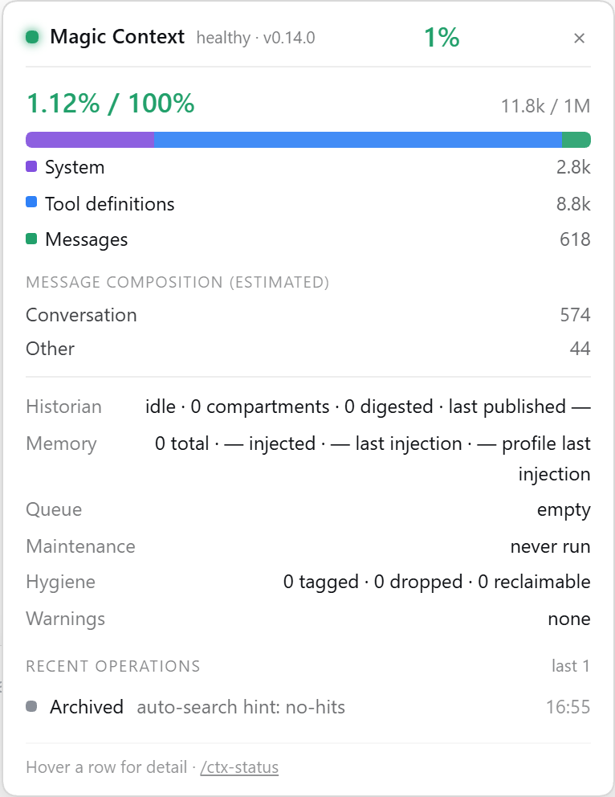

# Magic Context for DeepSeek Harness — elvisw fork

[](https://github.com/elvisw/dsh-plugin-magic-context/actions/workflows/ci.yml)
[](https://www.npmjs.com/package/@elvisw/dsh-magic-context)
[](LICENSE)
[](package.json)
[](package.json)

> **English** | [简体中文](README.zh-CN.md)

> Anyone who has run long sessions knows the symptoms: the project details you worked out
> yesterday are gone today, so the same pit gets re-dug; tool outputs bloat the context
> window; and every compaction busts the cache prefix, so the expensive part re-runs.
>
> [Magic Context](https://github.com/cortexkit/magic-context)'s answer: **knowledge should
> persist, context should be managed.** This plugin gives **DeepSeek Harness (DSH)**
> sessions a **persistent, project-aware memory** — knowledge distilled from your sessions
> survives restarts, is searchable with hybrid full-text + local vector search, and is
> re-injected right where the model reads it — while the context window itself is run as
> an asset: tool results become tagged, reclaimable history, digests come back as
> four-level summaries, and none of it ever breaks the live KV-cache prefix.

- **Memory that outlives the session** — a project corpus in the plugin's own SQLite store;
  historian facts auto-promote into it, `ctx_memory` reads/writes/maintains it, and project
  identity is auto-derived (git root or directory).
- **Local-first retrieval** — MiniLM embeddings via WebAssembly (no native build, no API
  keys), hybrid full-text 0.7 / vector 0.3 ranking, fail-open to full-text on any failure.
- **Sharing with a human gate** — machine/org global domains: staging can be automated,
  publishing is always yours (approval cards, `/ctx-global approve`); a user-profile layer
  rides on top with read / collect / review as separate switches.
- **Reversible reclaim, cache-aware compaction** — `ctx_reduce` only queues; drops land as
  `[dropped §N§]` placeholders and `ctx_expand` returns the original as a new result; history digests into
  p1–p4 summaries published as range replacements — never a spontaneous prefix bust.
- **Conservative by default** — the host `compaction-basic` engine stays in place unless
  you explicitly opt in; in DSH 0.2.2-rc.1, Web and Desktop agent presets own their own
  compaction engine, so `registerCompactionEngine` is a flat/headless-host seam, not a
  Web/Desktop preset override.

Requires **Node ≥ 22.19** and a **DSH 0.2.x host with the Web client** (the desktop app or
a `web` profile). The quick start below uses the Web profile; the Desktop profile is not
separately verified. The optional compaction takeover is for flat/headless compositions
and is **not effective on DSH Web or Desktop**. The package ships compiled — install
straight from the npm registry:

```bash
dsh plugin --profile web add @elvisw/dsh-magic-context
```

> Package identity: the unscoped `dsh-magic-context` on npm is an unrelated
> implementation by another maintainer, not this fork or its upstream. This fork
> is published only as `@elvisw/dsh-magic-context`; keep the `@elvisw/` scope in
> every install command.

`0.13.0` introduced this package name; the current release is `0.16.0`, which adds
remote vector search and the host-native Settings redesign (`0.15.0` added the
telemetry v2 panel; `0.14.0` added the top-level Settings page). If you installed
`@elvisw/dsh-plugin-magic-context` (0.12.x) or the upstream
`dsh-plugin-magic-context`, remove it first: all three use the same loader row id
(`magic-context-dsh`), so co-install is unsupported: the loader keeps one row and
settings may disappear. Upgrading from 0.12.x also
needs the one-time profile patch migration described in
[docs/independent-package-release.md](docs/independent-package-release.md); the helper is
shipped in the npm tarball and the hand-out bundle.

New to the plugin? A five-minute tour follows in [Quick start](#quick-start);
configuration, tools and architecture are covered in full below. A complete Chinese
translation is at [README.zh-CN.md](README.zh-CN.md). Contributions are welcome — see
[CONTRIBUTING.md](CONTRIBUTING.md) and [SECURITY.md](SECURITY.md).

## Quick start

After installing, restart the profile unless it has HMR enabled; with HMR the new
version hot-loads. In your next session:

- Tool results carry `§N§` tags; a **telemetry badge** appears in the overlay showing live
  context occupancy, with a panel of host token composition, estimated message breakdown,
  localized sections and an operation record behind it.
- A **Settings → Magic Context** page edits the options the card exposes. The legacy
  Plugins-page card is removed; a host without the `settings.section` slot has no
  Magic Context configuration card.
- The `ctx_reduce` / `ctx_expand` / `ctx_memory` tools are registered for the agent;
  project memory is **on by default** — facts distilled by the historian persist across
  sessions and surface where the model reads them.

Context reclaim, in one exchange (real parameter names):

```text
you:   ctx_reduce {"drop": "4-7"}      # four tool outputs are no longer worth the tokens
agent: queued 4 item(s) — the drops land as placeholders in the next reclaim band
…later in the transcript…
[dropped §4§] [dropped §5§] [dropped §6§] [dropped §7§]
you:   ctx_expand {"tag": "5"}         # wait — what was in §5 again?
tool:  the original text of §5, as a new result — the §5 placeholder stays dropped
```

The only opt-in surface is the compaction takeover (`registerCompactionEngine`, off by
default — see [Configuration](#configuration)); in DSH 0.2.2-rc.1 it applies to
flat/headless profiles whose root compaction-basic row is disabled, not to Web or Desktop
agent presets.

## What it does

Memory first, context management second — the first five rows are the memory system, the
last five manage the context window (full design in [Architecture](#architecture) and
[PARITY.md](PARITY.md)):

| Capability | Mechanism |
|---|---|
| **Project memory (own corpus)** | Plugin's own SQLite store (`memories.db`), hard-split from upstream — no shared storage, no compatibility duty. Project identity auto-derived (`git:<root-sha>` / `dir:<hash>`); injected into the m[0] baseline and served to `ctx_memory` for read/write; historian facts auto-promote; FTS 0.7 / vector 0.3 hybrid retrieval |
| **Local vector lane** | MiniLM embeddings run locally via the bundled onnxruntime-web WASM backend — no native build, no API keys; the model download is pinned by revision + sha256 (mirror fallback), cached in the plugin data dir; retrieval candidates get inline + maintenance-tick backfill; any failure fails open to full-text search |
| **m[0]/m[1] memory baseline** | A synthetic notice node carries the frozen baseline plus incremental lanes (`<new-memories>` / `<memory-updates>` / `<user-profile>`); each lane keeps its own watermark, so new memory never rebuilds the cached prefix — unchanged content produces zero diff |
| **Global domains + user profile** | machine/org domains: **staging can be automated** (maintenance tick, LLM classification), **publishing is always human** (approval cards, `/ctx-global approve`); the user profile's render / collect / review are separate switches |
| **Maintenance tick (MC dreamer slice)** | Every 30 min: TTL archiving → batched LLM verify (keep / update / archive) → vector backfill → global-domain candidate staging |
| **Reversible context reclaim** | Tool results get `§N§` tags; `ctx_reduce` **only queues** — drops land in the execute band as `[dropped §N§]` placeholders referencing the originals; `ctx_expand` returns the original text as a new result while the placeholder stays dropped. The cached prefix is never busted spontaneously |
| **Pressure scheduling** | Persistent usage (incl. cache reads/writes) → pressure score → execute/defer decisions (65% threshold, 5 min cache TTL, 85% force band); `CONTEXT_WINDOW_EXCEEDED` triggers emergency reclaim + retry; tiered reduce-guidance nudges |
| **Historian (out-of-band digest)** | One LLM call replays the real prefix (KV cache preserved) → four-tier p1–p4 summary + facts/events, **writes the store only, never touches the wire**; published in the execute band as a `[compacted §C<n>§]` range replacement; `/ctx-recomp` redoes compacted history in place |
| **Compaction seam** | `registerCompactionEngine` can take over root `ctx.compaction` (real `compaction/start\|summary\|replace\|end` protocol); **off by default** — the host compaction-basic (root or preset) stays in place. **Flat/headless only**: in DSH 0.2.2-rc.1, Web and Desktop agent presets mount their own compaction engine, so this switch does not replace a preset engine |
| **UI integration** | Top-level **Settings → Magic Context** page (the legacy Plugins-page card is removed; volatile fields, save = live); catalog-backed Historian reasoning-effort picker; `shell.overlay` telemetry badge + capsule panel (host token composition, estimated message breakdown, localized sections, operation record); `session-notice` rows in the session stream; Chinese/English instant switching for card labels and panel section/empty-state copy (operation detail values stay as recorded) |

## Installation

From the npm registry — recommended; the package ships compiled `lib/` and `vendor/`, no
local build needed:

```bash
dsh plugin --profile web add @elvisw/dsh-magic-context
```

Registry versions are published automatically by tag pushes (with npm provenance
signatures); see the "Releasing" section of [CONTRIBUTING](CONTRIBUTING.md).

### From source (development)

```bash
git clone https://github.com/elvisw/dsh-plugin-magic-context
cd dsh-plugin-magic-context
npm install
npm run build     # tsc → lib/ (multi-file ESM) + browser half copied to lib/client.js
dsh plugin --profile web add <path to this repo>   # the CLI ships with the app; the spec can be a Git URL, a local path, or a registry version
```

Installing does three things: `pnpm add` into the profile (`link:` for local paths),
appends the package name to `dsh.profile.bundles`, and the loader composes it. When the
profile has HMR enabled, changes take effect immediately (no restart; running sessions
start tagging right away); otherwise reload the page or restart the profile.

- All `@deepseek-ai/*` in `peerDependencies` are declared `"*"` — the compatibility
  precheck passes on any DSH 0.2.x; the host packages actually imported at runtime are
  also listed as **exact-version dependencies** (resolved with the package; `link:` dev
  installs are served by this repo's own node_modules).
- **Node ≥ 22.19** required: the stores build on the built-in `node:sqlite`, no native
  modules. A CLI/`web` profile runs on Node; the desktop app supplies an Electron
  RunAsNode runtime; both need the `node:sqlite` version that Node 22.19 provides.
- **Tool-constructor resolution**: `config.defineTool` (host-injected, used by in-tree
  glue) first, then dynamic `import('@deepseek-ai/dsh-tools')` (a hard dependency,
  physically resolvable in every install shape). If both are unavailable the mount **fails
  loudly** — the ctx_* tools are the only entry point for reclaim tags; no silent
  half-boot.
- Two loading modes: **patch-overlay / file URL** (development: overlay yml +
  `config.defineTool` injection) and **profile install** (production: package-name line +
  link dependency). The production path is the `dsh plugin add` above.

Uninstall / disable: disable the bundle on the GUI Plugins page (writes `disabled` into
the profile patch), or `dsh plugin --profile web remove @elvisw/dsh-magic-context`.

## Configuration

Two ways to change configuration, with different semantics (see the
[Settings UI contract](docs/dsh-plugin-settings-ui-contract.md)):

- **GUI settings page (Settings → Magic Context)**: exposes `policy.*` (incl. historian
  generation cap / ceiling / timeout), `historianEnabled`, `registerCompactionEngine`,
  `journal.*`, `maintenance.*`, `historian.*`, `embedding.*` and other volatile
  fields. The two
  provider/model **route pins** (maintenance verify, historian generation) prefer a
  dropdown fed by the **host's configured model catalog** (client
  `remote.session.modelCatalog()`), with "Auto = follow the session route" and clearing;
  shells without that RPC fall back to plain text (values remain hand-editable). The
  `embedding` model list comes from the plugin's own `/mc-embedding/models` endpoint,
  not the host catalog. The
  Historian reasoning-effort field is the same catalog-backed picker: `Default`, the
  routed model's advertised ids, and `Custom` for legacy/unknown values; an Auto route
  keeps the text input. Writes go through the settings chain: non-volatile keys are
  preserved untouched, untouched fields never materialize into override rows — **saving
  takes effect immediately** (the host side always reads through
  `liveNumber/liveBoolean/liveString/liveRoute` at the decision point).
- **Hand-written profile override rows**: `config` **replaces** the package patch's config
  wholesale — it is **not** a deep merge. Writing only `memory:` erases
  `registerCompactionEngine: false`. When hand-writing overrides you must spell out every
  key you want to keep.

The bundle's built-in config is one line: `registerCompactionEngine: false` — a
conservative first install that keeps the host compaction engine in place (memory, reclaim
and historian are on by default).

> **Scope:** the GUI switch only controls the root `ctx.compaction` seam. In DSH
> 0.2.2-rc.1, Web and Desktop agents run inside per-agent presets; each preset mounts its
> own `compaction` group, so a profile-patch top-level `compaction-basic` row does not
> replace the preset engine. The switch is therefore **flat/headless-host only**, and it
> only takes effect after the root `compaction-basic` row in that composition is disabled.
> The upstream 0.11.2 README's two-row recipe has the same flat-only limitation; see
> [upstream issue #16](https://github.com/wk544863858/dsh-plugin-magic-context/issues/16).

For a flat/headless profile that does not mount a preset-owned compaction engine, a
manual profile override can take over compaction:

```yaml
- id: magic-context-dsh
  name: '@elvisw/dsh-magic-context'
  config:
    registerCompactionEngine: true
- id: compaction-basic
  name: '@deepseek-ai/dsh-compaction-basic'
  disabled: true          # flat/headless only; not a DSH Web/Desktop preset override
```

Configuration reference (full types in [src/dsh/config.ts](src/dsh/config.ts); all keys
writable as profile override rows unless noted):

| Group | Keys (defaults) | Notes |
|---|---|---|
| Master switches | `enabled` (true) · `registerTools` (true) · `registerStatusCommand` (true) · `sessionNotices` (true) · `reduceGuidance` (true) · `searchHint` (true) | `enabled: false` stays loaded but fully inert; `sessionNotices` controls the management notice rows in the session stream |
| Compaction seam | `registerCompactionEngine` (code default: mount when resolvable; **ships false in the bundle**) · `compactionBase` (host-injected base class) | Flat/headless root seam only; that composition must disable its root compaction-basic row. In DSH 0.2.2-rc.1, Web and Desktop agent presets own their own compaction engine, so this key does not replace a preset engine. Pre-step `reconcileEngine` mounts/unmounts dynamically every step |
| Pressure policy | `policy.*`: `executeThreshold` (65) · `forceThreshold` (85) · `ttlMs` (5 min) · `assumedContextWindow` (256k) · `protectedToolResults` (8) · `historianTimeoutMs` (120 s) · `historianMaxTokens` (8192, raised to 8192 if set lower) · `historianMaxTokensCeiling` (32768) · `baselineTokens` (2000) · `memoryBudgetTokens` (8000) · `memoryLimit` (40) · `forceWaitReadyMs` (0) | Thresholds take effect at the next decision point (incl. `/ctx-status` and the compaction-engine paths). `compartmentGuardMode` / `compartmentEntrantTokens` (publish guards) were retired and are no longer configurable |
| historian | `historianEnabled` (true) · `historian.{provider, model}` (**pinned as a pair**; empty = follow the session's last route) · `historian.reasoningEffort` (optional, blank = model default) | Generation route for out-of-band digests and `/compact` summaries; the GUI Settings page has "Historian provider/model" dropdowns (Auto = follow session, recommended) and a catalog-backed reasoning-effort picker: `Default`, the routed model's advertised ids, and `Custom` for legacy/unknown values. The Auto route keeps a text input because the session model is unknown there; an unadvertised id is never silently remapped or clamped. A provider-level `OUTPUT_TOKEN_LIMIT` empty completion is retried with the normal cap escalation. The only LLM spend besides verify |
| Project memory | `memory.{}`: `enabled` (true, on by default since 0.9.0 — opt out with `enabled: false`) · `dbPath` · `project` (omitted = session cwd) · `domainProjects` · `shareCategories` · `autoPromote` (true) · `write` (true) | `write: false` makes `ctx_memory` read-only |
| Retrieval / vectors | `memory.embedBackfill` (true, query-side inline backfill) · `memory.vectorBackfill` (true, maintenance-tick backfill) · `memory.vectorBackfillLimit` (24 rows/tick) | Any vector-lane failure fails open to FTS |
| Remote embeddings (T20) | `embedding.provider` (local) · `embedding.preset` (siliconflow) · `embedding.endpoint` · `embedding.authHeader` (authorization) · `embedding.model` · `embedding.apiKeyEnv` (empty = no auth for custom; SiliconFlow falls back to `SILICONFLOW_API_KEY`) · `embedding.dimensions` (0 = probe) · `embedding.queryInstruction` · `embedding.documentPrefix` · `embedding.timeoutMs` (8000) · `embedding.queryTimeoutMs` (2500) · `embedding.batchSize` (16) | Optional OpenAI-compatible remote space. Model IDs are discovered through `/models` or typed manually; dimensions are probed, never compiled in. The block is declared user-level; the current host does not expose a project/tier source, so project-level rejection is not enforced at runtime. The key is read from the named environment variable, and remote space is namespaced `embedding-remote:…`. Saving remote config does not spend quota; `Start rebuild` arms the target, `Pause/Resume` and rollback (via the normal Save) manage it. Remote search never mixes local vectors and fails open to FTS |
| S(t) decay | `memory.scoring.{enabled (true), alpha (0.4), beta (0.2), archiveThreshold (2), halfLives}` | Stats are always collected; the distribution default enabled=true takes over ranking; profile-JSON only, not on the settings card |
| Global domains | `memory.global.machine.{enabled (true), excludeProjects, autoStage (true)}` · `memory.global.user.{render (true), collect (true), review (true)}` · `memory.global.review.batchLimit` (50) | Defaults all on: staging can be automated (≤3/pass, paused at ≥10 pending candidates), **publishing is always human**; LLM classification failure is fail-closed |
| User profile | `memory.global.user.{render (true), collect (false), review (false)}` | Read / collect / review are independent halves; the two halves that write to the shared store are off by default |
| Domain resolution | `memory.domains.source` (`adapter` \| `contract`) | `contract` is a fallback pole for comparison, not a supported end state |
| Maintenance | `maintenance.{enabled, intervalMs (30 min), verifyProvider, verifyModel}` | LLM verify needs an explicit route (unpinned = follow the conversation's latest route); the GUI card offers host-catalog dropdowns, Auto = unpinned (same picker for both pins) |
| Observability | `journal.{enabled (true), level (info), retentionDays (30), mirror (true)}` | level/mirror apply to the next write; a journal that was off at mount needs a restart to turn on at runtime; `retentionDays` has a `min(1)` floor against accidental pruning. §N§ tag rows have no age-based TTL; this adapter has no automatic message/session deletion path today |

### Remote embedding (optional)

The default vector lane stays local MiniLM. To use an OpenAI-compatible embedding
API (for example SiliconFlow), open **Settings → Magic Context → Embedding
search**, choose `OpenAI-compatible API`, load the model list, select a model and
press **Test connection**. The server probes one short input to learn the
dimension; model IDs and dimensions are not compiled into the plugin. The API
key is read from the environment variable you name — the value is never written
to config, logs, the database or the browser.

Press **Start rebuild** to arm the target space and begin a bounded backfill.
Until then, remote search is full-text only and saving the config sends no
embedding request. Old local vectors are kept, and **Roll back to local** stages
the provider change through the normal revision-fenced Save. Remote failures
degrade to full-text search; they never fall back to local vectors. The target
space is namespaced, and coverage covers `active` plus `permanent` memories.

This is a local-first plugin: enabling a remote endpoint sends the memory text
you search to that endpoint. Use a trusted or self-hosted endpoint, and prefer
HTTPS (plain HTTP is only expected for localhost/LAN servers). Model availability
and pricing change; check the vendor's current pages, for example the
[SiliconFlow API docs](https://api-docs.siliconflow.cn/docs/api/models-get) and
[embeddings docs](https://api-docs.siliconflow.cn/docs/api/embeddings-post).

## Tools & commands

Agent tools (registered at mount; `registerTools: false` turns them off):

| Tool | What it does |
|---|---|
| `ctx_reduce` | Parses MC range syntax (`"3-5,8"`) → **queues only**; landing is a priced bust that waits for the reclaim band, never spontaneous |
| `ctx_expand` | **Returns the original text as a new result**, read from the persisted log by `tag` (single), the deprecated `tags` alias, or `message` (a DSH log event seq in the current session for an already dropped item; `[compacted §C…§]` nodes are not accepted) — the old placeholder and its spent tag stay in place. Tag is primary; message is a fallback, not a general history browser. `start`/`end` (inclusive DSH log event seq, not upstream message ordinals) read a read-only `user`/`assistant`/`tool/result` transcript without requiring a drop; `verbose` previews 200 characters per part under the shared 15k budget. `[compacted §C…§]` bookkeeping is excluded while `[dropped §N§]` stays literal when the range reads raw history; a range whose readable events are all still live returns a live-surface sentence instead of duplicating them. No recovery is promised once the raw event is gone |
| `ctx_memory` | The shared memory store's read/write port. Reads: `list` / `search` / `get`; writes: `write` / `update` / `archive` / `merge` (with MC's normalized content hashing, mutation log and authority guards in the loop throughout); `review_global` (surfaces machine/org domain candidates one by one as approval cards; publishes only on approval); `promote` (stages a single project memory instantly — a manual lane with no recurrence gate). Every action accepts `project` (absolute path or git root) to operate on another project |

Slash commands (`registerStatusCommand: false` disables this command surface):

| Command | What it does |
|---|---|
| `/ctx-status` | pressure / decisions / reclaim ledger / compartments / baseline / policy |
| `/ctx-flush` | mark this session's pending `ctx_reduce` drops for landing on the next message; reports requested/already/pending counts; when the queue is empty, reports the last landed drop count/time for this session; starts no historian, recomp, summary, or model call |
| `/ctx-recomp` `all` \| `last:<n>` \| `<startSeq>-<endSeq>` | re-runs the historian and **replaces the stored digest in place** (ranges snap to compartments, never split; identity and landed placeholders unchanged, the next pre-step rebuilds the baseline) |
| `/ctx-profile` `confirm` \| `reject` \| `retire` | confirm / reject / retire user-profile candidates; promotion into the shared profile happens at the next maintenance tick |
| `/ctx-global` `add` \| `remove` \| `status` \| `promote` \| `approve` \| `reject` | the manual lane for global-domain membership and candidate approval (same gate→publish path as the approval cards, `source_type=user`) |

Compared with cortexkit `v0.49.59`, `/ctx-wrapup`, `/ctx-dream` and `/ctx-embed`
are not registered. `/ctx-wrapup` would need a manual historian pass over the
live tail; `/ctx-dream` needs the full dreamer task set; `/ctx-embed` targets
session-history compartments, memories and git commits, while this adapter's
embedding controls cover the memory vector lane. The exact command-by-command
matrix is in [PARITY.md](PARITY.md#command-surface-upstream-commands-checked-at-v04959).

## UI & telemetry

Both UI capabilities ride the same browser half (`src/client/index.js`, copied verbatim to
`lib/client.js` at build time):

- **Settings → Magic Context** (top-level Settings page): a five-section layout with a
  four-metric summary, jump row, advanced disclosures and a text-only status strip above
  the host footer. Volatile options are saved through the host footer. The legacy
  Plugins-page card is removed; a host without the `settings.section` slot has no card.

  

  

  

- **`shell.overlay` telemetry badge + capsule panel**: the collapsed pill keeps the live
  pressure, token pair, Historian state and reclaim queue (`H` / `Q<n>`) visible, and
  switches to an icon-width variant on narrow composers. The panel shows:
  - a 100% host token bar split into **System / Tool definitions / Messages**, with the
    absolute token pair (`11.8k / 1M`);
  - an **estimated message composition** (Conversation, Tool calls, Compartments, Memories,
    Profile, Other); rows with no estimate are omitted rather than shown as `0`;
  - **Historian / Memory / Queue / Maintenance / Hygiene / Warnings** sections, using
    `—` / `empty` / `never run` for values the host did not report;
  - the **live operation record** (up to 12 entries, adjacent identical operations folded
    as `×N`): 🧠 memory write · 🔎 memory load · 🗑️ reclaim queued · 🧭 original restored ·
    ✂️ context compacted · 🗑️ context dropped · 🧭 archived-stored · 🧰 maintenance sweep ·
    ⚠️ failure.

  Focus stays inside the panel while it is open; clicking outside the panel/badge, Esc,
  window blur, or the close button closes it and returns focus to the pill. The footer
  offers `/ctx-status` for the full diagnostic view.

  
- Data comes from the plugin's own HTTP routes (the harness's Remote event whitelist is a
  compile-time constant; the supported seam for third-party bundles is
  `ctx.webServer.register`):
  - `GET /mc-telemetry/summary` — one-shot snapshot (adapter / project / health + recent
    events). The v2 payload adds `adapterVersion`, `policy`, `contextBreakdown`,
    `messageComposition`, `historian`, `queue`, `memory` and `surface`.
  - `GET /mc-telemetry/events` — SSE live tail
- **Security**: the routes are loopback-only with no token auth, so they **emit counts and
  one-line summaries only** — no message bodies, no file paths, no credentials.
- **Languages**: browser-side `magic-context` namespace dictionaries (zh/en); every
  card-owned label, hint, route placeholder, summary, form frame and picker caption follows
  Settings → General instantly without a refresh. The telemetry pill and panel use the same
  dictionary, so their labels, section names and empty-state copy switch with the host
  language too. Host catalog values (provider/model/effort names) stay as the host sends them. The `session-notice` rows written into the session
  stream (model-visible) stay English constants (to avoid cached-prefix churn from
  mid-session language switches). Mechanics in the
  [Settings UI contract](docs/dsh-plugin-settings-ui-contract.md) and the
  [historical UI telemetry host analysis](docs/dsh-plugin-ui-telemetry-contract.md).

## Observability & operations

Desktop **does not persist `ctx.logger` output**, so the plugin writes its decisions and
outcomes into its own append-only journal:

- `~/.local/share/cortexkit/magic-context-dsh-poc/dsh-magic-context.db` → `journal` table
  (structured, SQL-queryable)
- `~/.local/share/cortexkit/magic-context-dsh-poc/activity.log` → single-line text mirror
  (`tail`/grep friendly, auto-rotates to `.1` past 5 MiB)

**Privacy**: message bodies are **never logged**. Only counts, tag numbers, token
estimates, reasons and durations; strings truncate at 300 chars, arrays cap at 20 items
(`redactData` as the backstop).

Journal coverage (by group): lifecycle (`boot` / `config-drift` / `session-first-seen`);
reclaim & compaction (`pass` — every execute recorded, with **tokensBefore→After
net-reclaim proof** and defer reasons, `drop-landed`, `compartment-published`/`-recomp`/
`-guard`, `force-path`, `emergency-reclaim`, `context-pressure`); historian & baseline
(`historian` — start/done/failed pairs with LLM usage, `baseline`, `session-notice`,
`wire-repair`); memory (`memory-recall` / `profile-recall` / `memory-promote` /
`memory-stats` / `vector-lane` / `search-hint` / `project-drift` / `global-review`);
maintenance (`maintenance`); tools & engine (`tool-call` / `engine` / `error` — every
exception swallowed fail-open).

### Operations commands

```sh
npm test               # vitest run
npm run gate           # full gate: typecheck + suite + build + acceptance + memory audit + records
npm run doctor         # read-only health report: corpus fence / event-lane heartbeat / dangling runs / embedding lane

node scripts/mc-report.mjs --days 7 [--json] [--session <id>]   # journal retrospective report
node scripts/mc-acceptance.mjs [--hours 72 --json]              # corpus acceptance, exit 1 on failure
npm run phase          # phase gate: run one phase's suite with verdict and blind spots
```

The retrospective report includes: stores and status, per-kind/per-day counts, key metrics
(execute/defer ratio and reason distribution, net reclaim, historian failure rate and
duration, emergency reclaims, tool calls), recent event details and health hints ("no
execute pass in the window" / "historian never ran" / "errors present" / "latest journal
event older than 24h", …).

`scripts/` specialists: retrieval-weight A/B (`retrieval-eval`), S(t) ranking offline diff
(`score-diff`), dilution & fold dashboard (`report-dilution`), domain-hit stats
(`report-hits`), historian failure classification (`report-classify`), embedding-model
precheck (`embedder-precheck`), reference-seed rebuild (`npm run build:seeds`),
panel-category validation (`mc-records-check`), i18n check (`npm run check:i18n`).

## Architecture

```
src/
  dsh/     # ← the ONLY directory allowed to import @deepseek-ai/* (the
           #    anti-corruption layer). Event names, payload shapes and the
           #    surface vocabulary all live here; a DSH upgrade touches this
           #    directory only.
  core/    # Neutral logic and storage: policy/stores/journal/memory-*/domains.
           #    No DSH dependency.
  client/  # Browser half (settings card + telemetry badge), plain JS,
           #    copied verbatim to lib/client.js at build time.
  index.ts # Composition root: boot probe (fail-loud) → seam listeners →
           #    neutral stores.
```

Isolation discipline (DSH is in developer preview; breaking changes are expected — this
package's structural answer):

- **Fail-loud capability probing**: `probeDshSeams` validates seam availability at boot and
  throws when absent — never silently pretends to manage context;
- **Version fences**: the adapter DB schema chain is at **v11** (forward migrations; a
  newer DB refuses to open); the **own corpus** `memories.db` inherits the **v95** starting
  point (switched 2026-10-13, numbering owned by this plugin; `MEMORY_SCHEMA_MAX_VERSION`
  guards the migration line) — beyond it, reads refuse and writes degrade to read-only
  with a loud warning;
- **Tests as probes**: the integration tests double as seam-contract tests — rerun after a
  DSH upgrade and breakage localizes to `src/dsh/`;
- **Two-database layout**:
  - **Adapter DB** `~/.local/share/cortexkit/magic-context-dsh-poc/dsh-magic-context.db`
    (tags / usage / pending_drops / compartments / baseline / domains / queues / journal…,
    schema v11);
  - **Own corpus** `~/.local/share/cortexkit/magic-context-dsh-poc/memories.db` (project
    memories + global-domain rows + profile + vectors; the legacy `context.db` is sealed
    and unread — the 2026-10-13 hard split; the upstream relationship is feature-following
    only, no storage-compat duty);
- **Upstream parity ledger**: effective-behavior alignment and deliberate differences
  against the OpenCode / Pi adapters are tracked in [PARITY.md](PARITY.md) (aligned /
  host-imposed / intentional verdicts, each citing host files).

## Documentation index

The linked documents are maintained in this repository; most are written in
Chinese and a few are English.

### Current documentation maintained by this fork

- [Magic Context Settings UI contract](docs/dsh-plugin-settings-ui-contract.md) (English) — the
  current top-level Settings page, zh/en copy, and catalog-backed effort picker.
- [Operations runbook](docs/dsh-plugin-operations-runbook-2026-10-10.md) — daily/weekly checks,
  thresholds, recovery, and backup commands.
- [Upgrade follow-up](docs/dsh-plugin-upgrade-followup.md) — the current re-alignment procedure.
  Its §1 baseline is v0.49.30 and is **not** a v0.49.55 parity claim.
- [Independent package release](docs/independent-package-release.md) — package identity, migration,
  and release procedure for `@elvisw/dsh-magic-context`.

### Historical research and upstream snapshots

These are preserved for provenance. They are **not current guarantees**; each file has its own
`> Status:` header with the evidence baseline.

**Historical contracts**

- [Memory write contract](docs/dsh-plugin-memory-write-contract.md) — mixed 2026-10 storage snapshot;
  the current corpus is `memories.db`, and §8 authority is historical.
- [Memory promotion contract](docs/dsh-plugin-memory-promotion-contract.md) — upstream promotion research.
- [Memory acceptance](docs/dsh-plugin-memory-acceptance.md) — 2026-10 evidence (v6/v94 era).
- [Config UI contract](docs/dsh-plugin-config-ui-contract.md) — historical; its plugin-specific
  conclusions are superseded by the current Settings UI contract.
- [UI telemetry contract](docs/dsh-plugin-ui-telemetry-contract.md) — historical host-seam analysis.
- [Hooks coverage (2026-10-08)](docs/dsh-plugin-hooks-coverage-2026-10-08.md) — historical coverage audit.

**Design decisions**

- [Port feasibility (seam map)](docs/dsh-port-feasibility-2026-10-06.md)
- [Platform takeover & global domains](docs/dsh-plugin-platform-takeover-and-global-domains-2026-10-09.md)
- [Dreamer vector decision](docs/dsh-plugin-dreamer-vector-decision-2026-10-08.md)
- [Memory mechanisms inventory](docs/memory-mechanisms-inventory-2026-10-09.md)
- [Upstream source analysis](docs/upstream-source-analysis-2026-10-09.md)
- [Global-domain source finding](docs/global-domain-source-finding-2026-10-10.md)
- [Memory architecture challenge](docs/memory-architecture-challenge-2026-10-10.md)
- [Domain naming decision (2026-10-25)](docs/domain-naming-work-global-2026-10-25.md)

**Audits & retrospectives**

- [Test design audit](docs/dsh-plugin-test-design-audit-2026-10-07.md)
- [Surface write audit](docs/dsh-surface-write-audit-2026-10-09.md)
- [Local embedding runtime audit](docs/local-embedding-runtime-audit-2026-10-15.md)

**Reports**

- [Dreamer token usage](docs/reports/dreamer-token-usage.md)
- [Memory solutions comparison](docs/reports/memory-solutions-comparison.md)

**Upstream handoffs**

- [Upstream follow-up v0.46.0 → v0.49.30](docs/upstream-followup-2026-10-30.md)
- [/ctx-flush research handoff (0.11.1)](docs/research-handoff-ctx-flush-2026-11-11.md)

## Known limits

- Historian triggering and budgeting use **chars/4 estimates**, not a real tokenizer
  (retrieval vectorization does use a real one); the four-tier digest is produced in **one
  call** (MC accumulates across calls);
- `review_global` approval cards must be raised inside an agent turn; headless without a
  responder it refuses explicitly with zero state change;
- A journal that was off at mount needs a restart to turn on at runtime (all other
  journal / threshold changes apply immediately);
- Desktop does not persist the harness logger — observability rests entirely on the
  self-kept journal.

## Contributing

- Contributing guide: [CONTRIBUTING.md](CONTRIBUTING.md) (environment, code conventions,
  PR flow)
- Security reports go through the private channel: [SECURITY.md](SECURITY.md)
- Code of conduct: [CODE_OF_CONDUCT.md](CODE_OF_CONDUCT.md)
- Changelog: [CHANGELOG.md](CHANGELOG.md)

This repo uses npm as its only package manager (`package-lock.json` is the truth); CI runs
typecheck → test → build → check:i18n on Node 22.x / 24.x.

## Provenance & license

### Difference from the upstream DSH adapter

This repository is a fork of [`wk544863858/dsh-plugin-magic-context`](https://github.com/wk544863858/dsh-plugin-magic-context)
(npm `dsh-plugin-magic-context`). The upstream's last public release is `dsh-plugin-magic-context@0.11.2`
(2026-11-11); this fork published as `@elvisw/dsh-plugin-magic-context` from `0.12.0` through `0.12.3`,
and publishes as **`@elvisw/dsh-magic-context`** from `0.13.0`. Its versions and tags belong to the
fork. The upstream repository and npm package remain under their original maintainer; this fork does
not modify them.

Differences from upstream `0.11.2`, accumulated through `0.16.0`:

- **Recovery semantics**: `ctx_expand` no longer rewrites placeholders in place. It reads the persisted
  original `tool/result`, returns it as a new tool result, and assigns a new tag. The old placeholder is
  unchanged, the old tag stays dropped, and reducing it again is a no-op (`already dropped`). This is a
  breaking change.
- **Raw reads after Historian**: `ctx_expand` accepts a `message` locator (the current session's DSH log
  event seq, including an original `tool/result` shadowed by a Historian compartment). It does not rerun
  the original tool and does not rewrite summaries or compartments.
- **Manual flush**: `/ctx-flush` marks the current session's pending drops for the next pre-step to land;
  it does not start Historian, recomp, summarization, or a model call.
- **Durable drop state**: `ctx_reduce`/`ctx_expand` decide from the `pending_drops` `none`/`pending`/
  `landed` state instead of whether a placeholder is still on the current surface; a restored old tag no
  longer produces a fake “Queued” receipt.
- **Tag retention**: the mount-time 30-day tag prune, the `tags.retentionDays` config, and
  `AdapterStores.pruneTags` are removed. An old profile's key is kept but ignored, with at most one warning
  per process.
- **Settings UI**: the plugin registers only a top-level `settings.section` (Magic Context)
  with zh/en copy and a catalog-backed Historian reasoning-effort picker. The legacy GUI
  Plugins-page card is removed; a host without `settings.section` has no card.
- **Telemetry v2**: the overlay pill keeps pressure, the token pair, Historian state and queue
  visible; the panel adds a 100% host token composition bar, an estimated message breakdown,
  Historian/Memory/Queue/Maintenance/Hygiene/Warnings sections, and localized chrome. Missing
  host values render as `—` / `empty` / `never run`, never as fabricated zeroes.
- **Schema and package name**: the plugin DB moves to v11 (`pending_drops.flush_requested`, automatic v10
  migration). The npm package was `@elvisw/dsh-plugin-magic-context` in `0.12.x`; `0.13.0` renames it to
  `@elvisw/dsh-magic-context` without changing the loader row id `magic-context-dsh`, the settings
  namespace, the plugin data directory `magic-context-dsh-poc`, the schema, or the stored format.
- **Upgrade migration**: a `0.12.x` profile patch row still says the old package name; the DSH loader
  matches by both `id` and `name` and skips a mismatched row, so run
  `tools/migrate-profile-package-name.mjs --patch <cordis.patch.yml>` once before opening Settings.
  Plugin memories, journal, schema and a custom `dataDir` stay at the same paths; the rename performs no
  data migration. The `0.13.0` host gate is config-effective only and did not open the old database.

Because the row id is shared, co-installing upstream `dsh-plugin-magic-context`, the `0.12.x` fork
package, and this package is **unsupported**; remove the old package before installing the new one. The
gate observed only that a config dump accepts both rows and keeps both names. The loader keeping one
duplicate-id row and the settings editor hiding duplicate ids are source-level inferences, not
gate observations. This fork guarantees its own plugin behavior and data migration, not long-term
UX/API compatibility with upstream 0.11.x; compatibility semantics target the original
`cortexkit/magic-context`, with DSH as the host.

### Copyright and third parties

- **Upstream DSH adapter** (`wk544863858/dsh-plugin-magic-context`, npm `dsh-plugin-magic-context@0.11.2`,
  MIT, Copyright (c) 2026 wukai — the DeepSeek Harness adapter in this repository): the direct upstream of
  this fork. Fork modifications are Copyright (c) 2026 elvisw, also under MIT.
- **magic-context** (MIT, Copyright (c) 2025 Ufuk Altinok — magic-context): the derivative origin of this
  repo. Extracted from upstream tag v0.46.0 (`651c105a9`); the adapter's own commits were replayed verbatim
  from `e34eda955` (2026-10-08) on the local `dsh` branch.
- **DeepSeek Harness** (MIT): consumed as a dependency, not vendored. Code written against 0.2.1-rc.1
  (checkout `1600d8a1e`, npm dist-tag `next`; note their `latest` tag trails a release line — exact pins are
  the devDependencies).
- Vendored third-party: `vendor/onnx/` (onnxruntime-web WASM subset, MIT © Microsoft),
  `tests/helpers/mock-adapter.ts` (DSH test tree, verbatim). Details in [NOTICE](NOTICE);
  license in [LICENSE](LICENSE).
