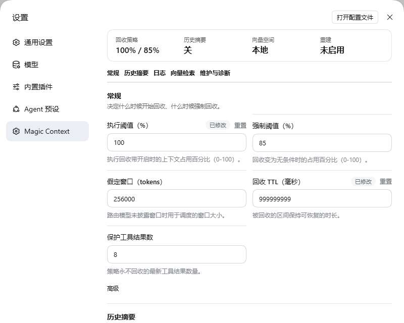

# Magic Context for DeepSeek Harness — elvisw fork

[](https://github.com/elvisw/dsh-plugin-magic-context/actions/workflows/ci.yml)
[](https://www.npmjs.com/package/@elvisw/dsh-magic-context)
[](https://github.com/elvisw/dsh-plugin-magic-context/blob/main/LICENSE)
[](https://github.com/elvisw/dsh-plugin-magic-context/blob/main/package.json)

> [English](https://github.com/elvisw/dsh-plugin-magic-context/blob/main/README.md) | **简体中文**

长会话里有两件事会反复发生。上个会话查清楚的东西，这个会话全忘光，同一个坑再踩一遍。工具输出越堆
越多，上下文被撑满；一压缩，缓存前缀全废，最贵的那一段重来一次。

这个插件把项目记忆和上下文管理接到 DeepSeek Harness 上：会话里提炼的事实存成项目记忆，跨会话
可用；工具输出能打标签回收，要用时把原文取回；被消化的历史会变成摘要，而不是直接丢掉。

安装是一条命令：

```bash
dsh plugin --profile web add @elvisw/dsh-magic-context
```

## 安装

需要 Node ≥ 22.19，以及带 Web 客户端的 DSH 宿主（桌面应用或 `web` profile）。DSH 即
[DeepSeek Harness](https://github.com/deepseek-ai/deepseek-harness)。支持的宿主版本写在
`engines.dsh` 里：`0.2.1-rc.1` 或 `0.2.2-rc.1`。

上面那条命令装的是 `web` profile。桌面应用有自己的 profile，那边用 `--profile desktop`，
或者换成你自己的 profile 名。

包内自带编译产物，装完重启 profile 就能用；该 profile 开了 HMR 的话会热加载。

从 0.18.0 起，Android 的 dsh-go 1.1.0 用同一个包，见 [Android](#android)。

> **包名。** npm 上无 scope 的 `dsh-magic-context` 是另一位维护者的独立实现，不是这个 fork，
> 也不是它的上游。本 fork 只以 `@elvisw/dsh-magic-context` 发布，装的时候 `@elvisw/` 不能省。

装过旧包的先卸掉：`dsh plugin --profile web remove @elvisw/dsh-plugin-magic-context`，`--profile`
与安装时一致。本 fork 的旧包名是 `@elvisw/dsh-plugin-magic-context`（0.12.x），上游是
`dsh-plugin-magic-context`。三者共用一个 loader row id（`magic-context-dsh`），装在一起只会
加载一行，设置页可能直接消失。从 0.12.x 升级还要迁一次 profile 补丁里的包名，
步骤见[独立包名与发布](https://github.com/elvisw/dsh-plugin-magic-context/blob/main/docs/independent-package-release.md)。

## 装完会看到什么

后面反复出现的词先在这里交代完，细节和实现位置见[术语表](https://github.com/elvisw/dsh-plugin-magic-context/blob/main/docs/glossary.md)。

| 词 | 是什么意思 |
|---|---|
| `§N§` | 工具结果上的序号标签；由模型按它定位条目，你不需要手写 |
| overlay | 宿主界面上浮在对话之上的那层，遥测徽标挂在这里 |
| composer | 界面底部的输入框区域，胶囊贴在它上方 |
| surface | 宿主真正发给模型的那串消息；改写它会让缓存前缀失效 |
| 回收带 | 一次允许真正改写 surface 的时机，排队的回收在这里落地 |
| historian | 做摘要的角色，重放历史前缀产出摘要和事实，只写存储 |
| 压缩段（compartment） | historian 产出的一段摘要，覆盖一段连续历史 |
| 基线（baseline） | 每次请求都注入的固定内容（项目记忆、用户画像、全域），冻结不变 |
| FTS5 | SQLite 的全文检索扩展；它的中文表现见「已知限制」 |
| embedding（嵌入） | 把文本变成向量做语义检索，默认包内 MiniLM，384 维 |
| tick（维护循环） | 默认每 30 分钟一次的维护任务 |
| parity（门禁 / gate） | 共享向量空间的一致性校验，首次写入时先比对样本向量，不过就退回全文检索 |
| pre-step | 每次请求模型前宿主调用的钩子，插件的主要决策都发生在这里 |
| execute band | 压力过执行阈值（默认 65%）后进入的区间，historian 的产出在这里发布 |
| 强制带（force band） | 压力达到或超过它，插件不再等模型调 `ctx_reduce`，自己丢弃受保护窗口之外的带标签工具结果 |
| 受保护窗口 | 强制带不碰的区域：最新的若干条结果，累计不超过窗口的 5%（夹在 8k–64k token），且至少最新的八条（默认值） |
| 四层摘要 | historian 产出的 p1–p4 四档详略，同一份摘要按重要度降级使用 |
| flat/headless | 没有 Web 界面的宿主形态 |
| HMR | 宿主的模块热替换，开着时装完不用重启 |
| `H` / `Q<n>` | 胶囊上的缩写，`H` 是 historian 状态，`Q<n>` 是待落地条数 |
| defer（延后） | 另一种决策：这一步压力不够，先不改写会话 |
| token 用量 | 已用的上下文 token，以及用来对比的窗口上限 |
| 宿主侧 | 跑在 DSH 宿主进程里的那部分适配器 |
| 三态 | 回收状态：未排队、已排队、已落地 |

- 工具结果带上 `§N§` 标签。overlay 里多一个遥测徽标，显示实时上下文占用，点开是 token 构成和
  操作记录。
- 设置里多一个顶层「Magic Context」页。旧的「插件」页卡片已经移除，宿主没有
  `settings.section` 槽位的话就没有配置入口了。
- 三个工具注册好了：`ctx_reduce`、`ctx_expand`、`ctx_memory`。项目记忆默认开启，historian
  提炼的事实会自己沉淀下来。

它也会自己回收。日常回收由模型驱动：没有任何结果会因为“放旧了”被丢掉，`/ctx-flush` 只是把已经排队的
回收标记为下一条消息落地。例外是强制带：管理 pass 拿到当前压力读数、且达到或超过 `policy.forceThreshold`
（默认 85%）时，会自己把受保护窗口之外的带标签工具结果换成占位符。受保护窗口是从最新往前累计、总量
不超过上下文窗口 5% 的那些结果（夹在 8k 到 64k token 之间），外加至少最新的 `protectedToolResults` 条
（默认八条）；不知道上下文窗口时只剩这个条数下限。丢弃按类别而不是按年龄：其余工具最先丢，然后是
`edit` / `write` / `apply_patch` / `grep` / `glob`，`read` / `todowrite` / `task` 最后，同一类别里旧的先丢。
`/ctx-wrapup` 触发的 pass、没有压力读数的 pass、以及读数早于某次 `/ctx-flush` 落地、摘要发布或基线刷新的 pass
不会触发。如果丢光所有可丢结果、在已知窗口下仍然装不下，它也不丢。

回收掉的内容也没有丢。标签仍然是一个指针——模型发现某个已经用过的结果现在又要用到时，会自己调
`ctx_expand`，把原文作为新工具结果返回，占位符留在原地。这是模型的动作，不是用户的任务：
界面上没有任何地方要你挑标签。

如果提供商直接以请求过长拒绝，另一条路径先发布已就绪的摘要，再按同样的窗口和类别顺序丢弃，然后重试
一次——但只有在 surface 确实变化之后才重试；什么都没发布、什么都没丢时，重试只会得到同样的失败。
两条路径都没有各自的开关。

系统提示还会教模型养成 `§N§` 的习惯；当带标签的尾部达到 60k token、其中至少 25k 还没被丢弃时，
开始提醒。提醒的强度取决于尾部还有多少没丢：gentle、firm、urgent，最高一档是“下一步就做”——
未丢弃达到 50k 且占尾部四分之三时出现。同一档位最多每五个用户轮次重复一次。提醒只是要求，
它自己不丢任何东西。

## 常用操作

**这件事不用你管。** 按上面说的，模型用完输出就打标记，压力到 85% 时强制带丢弃受保护窗口之外的
带标签结果。排队中的回收要等到下一个**回收带**才落地，因为改写会话会让缓存前缀失效；如果希望已经
标记的回收现在就落地，`/ctx-flush` 会让排队的条目在你下一条消息时落地。你不用报标签号，也不用
挑哪一条该丢。

**记一条项目事实。** 记忆按项目隔离，项目身份从 git 根推导。模型学到该留下的东西时，
也可以自己发起这个调用。

```text
你：   记一下：发布前必须先让 main 的 CI 全绿
模型： ctx_memory {"action": "write", "category": "CONSTRAINTS",
                   "content": "发布前必须先让 main 的 CI 全绿"}
```

**现在就把旧历史压掉。** 自动摘要要等压力上来，`/ctx-wrapup` 给一个手动入口，保留最新 N 条。

```text
/ctx-wrapup 20
```

## 命令与工具

这些工具由模型调用：你用一句话提出需求，不需要自己写范围语法。下面的斜杠命令是给你直接敲的。

| 工具 | 作用 |
|---|---|
| `ctx_reduce` | 把模型标记的输出排进队列（范围或列表）；落地等回收带 |
| `ctx_expand` | 按 `tag`、`message`（会话日志事件 seq）或 `start`/`end` 区间取回原文 |
| `ctx_memory` | 记忆读写：`list` / `search` / `get` / `write` / `update` / `archive` / `merge`，另有 `review_global` 与 `promote` |

| 命令 | 作用 |
|---|---|
| `/ctx-status` | 压力、决策、回收台账、压缩段、基线、策略 |
| `/ctx-flush` | 把已排队的回收标记为下一次消息强制落地；不跑 historian，不调模型 |
| `/ctx-recomp` | 重跑 historian，原地替换存储里的摘要 |
| `/ctx-wrapup` | 为下一次 pre-step 排队一次手动压缩，保留最新 N 条（默认 20） |
| `/ctx-profile` | 用户画像候选的确认、拒绝、退休 |
| `/ctx-global` | 全域成员管理与候选审批 |

原版 Magic Context（`cortexkit/magic-context`）的命令集里，`/ctx-dream` 和 `/ctx-embed`
没有在这里注册。前者需要整套 dreamer
任务集；后者的目标是会话历史、记忆和 git 提交，而本适配器的向量只覆盖记忆。
逐条矩阵在 [PARITY.md](https://github.com/elvisw/dsh-plugin-magic-context/blob/main/PARITY.md)，
两个基线各自核对到哪个上游版本见「出处与许可」。

## 设置

设置页在**设置 → Magic Context**，五个分区加四项摘要，带跳转行和高级折叠；宿主底栏上方有一条
纯文本状态条。字段和说明中英文即时切换。




日常会动的几项：

- **Historian 路由。** 可以钉死 provider 和 model，也可以留空跟随会话。推理强度从宿主模型列表里选。
- **向量检索。** 默认本地 MiniLM。要换 OpenAI 兼容的嵌入（embedding）API（比如硅基流动），
  在这个分区选预设、加载模型、测试连接。密钥只写不读，存进宿主凭据库，卡片只显示「已配置 / 未配置」。
- **压缩接管。** 可以接管宿主的压缩引擎，但只对上面说的那种无界面形态有效，在 Web 和桌面端
  不起作用，默认关闭。
- 要关掉项目记忆，在 profile 补丁**已有的** `memory` 块里加 `enabled: false`。
  不要单独写一个 `config:` 块——它是整体替换而不是合并，会把 `registerCompactionEngine`
  这类包内键一起抹掉。

完整键表和默认值在[配置参考](https://github.com/elvisw/dsh-plugin-magic-context/blob/main/docs/configuration.md)。
手写 profile 覆盖行时注意 `config` 是**整体替换**，不是深合并。

**遥测徽标。** composer 上方有个胶囊，收起时显示实时压力、已用 / 上限 token、historian 状态
和回收队列（`H` / `Q<n>`），窗口窄了切成图标。点开是面板：宿主 token 构成条（系统 / 工具定义 /
消息）、估算的消息构成（对话 / 工具调用 / 压缩段 / 记忆 / 用户画像 / 其他）、历史摘要、记忆、
队列、维护几个分区，以及最多 12 条的实时操作记录。宿主没上报的值显示 `—`。
打开时焦点锁在面板内，点外面、按 Esc、窗口失焦或点关闭都能关，焦点还回胶囊。

## Android

同一个包为 **Android dsh-go 1.1.0**（[源码](https://github.com/ccch1mneyyy/dsh-Go)、
[发布版](https://github.com/ccch1mneyyy/dsh-Go/releases)）提供原生面板，选**手机本机引擎**。
不需要 Flutter 构建，也没有第二个包。dsh-go 之后又发过新版本；这里的原生面板是在 1.1.0 上验证的。

市场条目可用后，在「插件市场 → 适配 DSH Go」里搜 `@elvisw/dsh-magic-context`。搜不到就在
App 的本机终端装准确版本，然后重启引擎：

```bash
dsh plugin --profile web add @elvisw/dsh-magic-context@0.18.4
```

只有找到桥接时，宿主侧才注册状态条和面板；没有桥接的桌面端和 Web profile 照常加载。

- **输入框状态条。** 和桌面胶囊同源的摘要，比如 `上下文 62% · 待回收 3`。生成回复时让位给宿主。
- **上下文面板。** 从对话打开时严格按那个会话取数，从「全部功能」打开时标成全局视图。
  缺失值显示 `—`，不写成 0。手机端不重新统计 token。
- **向量检索面板。** 显示 provider、模型、探测维度、覆盖率、重建进度。可以加载模型 ID、
  测试连接、确认后开始重建、暂停继续。打开面板或保存配置都不会自动探测或重建。


远程向量的密钥在桌面或 Web 设置页录入。原生设置页声明了同一组 role，但 dsh-go 1.1.0 的桥接
还没把凭据引用传给 App，所以原生密钥输入框现在是禁用状态，见
[dsh-go issue #1493](https://github.com/ccch1mneyyy/dsh-Go/issues/1493)。在那之前手机端用本地
MiniLM 就行，不需要密钥。

2026-11-18 用已发布的 0.18.0 在同一台手机上跑通了完整本地向量链路：三条记忆由维护循环回填成
384 维向量，检索对同时命中关键词和向量的行返回 `match=hybrid`，对只有向量能找回的行返回
`match=semantic`，引擎重启后共享空间门禁报告 `parity: 1`。细节见
[T25 报告](https://github.com/elvisw/dsh-plugin-magic-context/blob/main/_bmad-output/initiative-dsh-magic-context/acceptance-android-dsh-go-2026-11-18-t25-local-vector/acceptance-report.md)。

还没测的：手机英文界面、iOS、长历史吞吐、真实厂商流量、中文关键词检索。

## 它访问什么

dsh-go 的插件市场会自动扫描包内容，本包被标成 high risk，四项标记是 `native-code`（high）、
`shell`（medium）、`network`（low）、`filesystem`（medium）。四项都不是摆设，
但有一项标出的文件数远多于真有行为的文件。下面逐个说清。

**native-code（high）** —— 只有 1 个文件触发：`vendor/onnx/ort-wasm-simd-threaded.wasm`。
它是 WebAssembly 字节码，不是原生模块，本包不需要任何原生编译。删掉它本地向量就跑不了，
只能改成必须联网、必须有密钥的远程方案。

**shell（medium）** —— 命中 12 个文件，真的导入 `node:child_process` 的只有 2 个：
`lib/core/memory-bridge.js` 跑 `git rev-list --max-parents=0 HEAD`，`lib/dsh/project-drift.js`
跑 `git rev-parse --show-toplevel`。两处都是 3 秒超时的只读调用。记忆桥在 git 不在时退回
目录哈希，漂移检查则直接不报告。另外 10 个是误报：扫描器的 `exec(` 正则同时命中了
`db.exec('PRAGMA …')` 这类 SQLite 调用和正则表达式自己的 `.exec()`，这 52 处都是这类误判。

**network（low）** —— 命中 7 个文件，每一个都能说清来路。`lib/core/embedding-local.js` 首次使用时
从 huggingface.co 或其镜像拉模型资产，sha256 钉死，下过就缓存。`lib/core/embedding-remote.js`
只在你配置了远程向量、并且显式点了测试连接、加载模型列表或开始重建之后才访问那个 endpoint，
不会自己发起。`lib/client.js` 里 4 处
`fetch()` 全是同源相对路径（`/mc-embedding/*`、`/mc-telemetry/*`），请求的是宿主自己的回环
路由，文件里唯一的绝对 URL 是输入框的提示文案。`lib/dsh/telemetry.js` 与
`lib/dsh/embedding-lane.js` 里的 `telemetry.invalid` / `embedding.invalid` 只是 `new URL()`
的解析基准，不会发出请求。剩下 2 个是 vendored 的 onnxruntime，我们传本地文件路径，运行时不触网。

**filesystem（medium）** —— 命中 6 个文件，这一项是准确的。适配器库、`memories.db`、journal
和模型缓存默认写在 `~/.local/share/cortexkit/magic-context-dsh-poc/`，都在工作区之外。
想换位置就设 `dataDir`。

## 已知限制

- historian 的触发和预算按字符数除以 4 估算，不是真 tokenizer。检索向量那条路用的是真 tokenizer。
- 摘要的四档详略在一次调用内全部产出，上游是跨调用累积。
- 中文关键词检索很弱。FTS5 的 `porter unicode61` 不切分中文，整段连续汉字算一个 token，
  所以中文查询基本只能靠向量通道。这是上游既有行为。
- `review_global` 的审批卡必须由 agent 在轮内触发。headless 没有应答器时会明确拒绝，不改任何状态。
- journal 如果在挂载时是关闭的，运行中再打开需要重启。
- 桌面端不持久化宿主 logger，可观测性完全靠插件自己记的 journal。

## 排障

宿主不持久化 `ctx.logger` 的输出，所以插件把决策和结果写进自己的 journal。两个落点都在数据目录下：
结构化、可 SQL 查询的 journal 表，以及单行文本镜像 `activity.log`（超过 5 MiB 自动轮转）。
消息正文永远不记录，只记计数、标签号、token 估算、原因和耗时。

```sh
npm run doctor         # 只读健康报告
node scripts/mc-report.mjs --days 7 [--json]   # journal 复盘
node scripts/mc-acceptance.mjs [--hours 72]    # 语料库验收，失败退出 1
```

复盘报告里有 execute/defer 比例、净回收、historian 失败率和耗时、紧急回收、工具调用统计，
以及「窗口内没有 execute pass」这类健康提示。journal 有哪些事件类型见
[架构文档](https://github.com/elvisw/dsh-plugin-magic-context/blob/main/docs/architecture.md)。

术语不熟可以查[术语表](https://github.com/elvisw/dsh-plugin-magic-context/blob/main/docs/glossary.md)。

## 文档

**当前维护的**

- [配置参考](https://github.com/elvisw/dsh-plugin-magic-context/blob/main/docs/configuration.md)——全部配置键、默认值和远程向量细节
- [架构与内部结构](https://github.com/elvisw/dsh-plugin-magic-context/blob/main/docs/architecture.md)——目录、双库、存储与检索、组件地图、journal 事件类型
- [术语表](https://github.com/elvisw/dsh-plugin-magic-context/blob/main/docs/glossary.md)——README 里出现过的内部词
- [设置界面契约](https://github.com/elvisw/dsh-plugin-magic-context/blob/main/docs/dsh-plugin-settings-ui-contract.md)——设置页的宿主接缝与文案规则（英文）
- [运维手册](https://github.com/elvisw/dsh-plugin-magic-context/blob/main/docs/dsh-plugin-operations-runbook-2026-10-10.md)——日常检查、阈值、故障处置
- [升级跟随](https://github.com/elvisw/dsh-plugin-magic-context/blob/main/docs/dsh-plugin-upgrade-followup.md)——重新对齐流程
- [独立包名与发布](https://github.com/elvisw/dsh-plugin-magic-context/blob/main/docs/independent-package-release.md)——包身份、迁移、发布流程
- [PARITY.md](https://github.com/elvisw/dsh-plugin-magic-context/blob/main/PARITY.md)——与上游适配器的逐条对齐

**历史资料**

以下只作溯源保留，不是当前保证。每份文件开头都有自己的状态说明和证据基线。

- [记忆写契约](https://github.com/elvisw/dsh-plugin-magic-context/blob/main/docs/dsh-plugin-memory-write-contract.md)
- [记忆提升契约](https://github.com/elvisw/dsh-plugin-magic-context/blob/main/docs/dsh-plugin-memory-promotion-contract.md)
- [记忆验收](https://github.com/elvisw/dsh-plugin-magic-context/blob/main/docs/dsh-plugin-memory-acceptance.md)
- [配置界面契约](https://github.com/elvisw/dsh-plugin-magic-context/blob/main/docs/dsh-plugin-config-ui-contract.md)
- [主界面遥测契约](https://github.com/elvisw/dsh-plugin-magic-context/blob/main/docs/dsh-plugin-ui-telemetry-contract.md)
- [hooks 覆盖](https://github.com/elvisw/dsh-plugin-magic-context/blob/main/docs/dsh-plugin-hooks-coverage-2026-10-08.md)
- [移植可行性](https://github.com/elvisw/dsh-plugin-magic-context/blob/main/docs/dsh-port-feasibility-2026-10-06.md)
- [平台接管与全域](https://github.com/elvisw/dsh-plugin-magic-context/blob/main/docs/dsh-plugin-platform-takeover-and-global-domains-2026-10-09.md)
- [dreamer 向量决策](https://github.com/elvisw/dsh-plugin-magic-context/blob/main/docs/dsh-plugin-dreamer-vector-decision-2026-10-08.md)
- [记忆机制清单](https://github.com/elvisw/dsh-plugin-magic-context/blob/main/docs/memory-mechanisms-inventory-2026-10-09.md)
- [上游源码分析](https://github.com/elvisw/dsh-plugin-magic-context/blob/main/docs/upstream-source-analysis-2026-10-09.md)
- [全域来源调查](https://github.com/elvisw/dsh-plugin-magic-context/blob/main/docs/global-domain-source-finding-2026-10-10.md)
- [记忆架构挑战](https://github.com/elvisw/dsh-plugin-magic-context/blob/main/docs/memory-architecture-challenge-2026-10-10.md)
- [域命名决定](https://github.com/elvisw/dsh-plugin-magic-context/blob/main/docs/domain-naming-work-global-2026-10-25.md)
- [测试设计审计](https://github.com/elvisw/dsh-plugin-magic-context/blob/main/docs/dsh-plugin-test-design-audit-2026-10-07.md)
- [surface 写审计](https://github.com/elvisw/dsh-plugin-magic-context/blob/main/docs/dsh-surface-write-audit-2026-10-09.md)
- [本地向量运行时审计](https://github.com/elvisw/dsh-plugin-magic-context/blob/main/docs/local-embedding-runtime-audit-2026-10-15.md)

## 参与

- [CONTRIBUTING.md](https://github.com/elvisw/dsh-plugin-magic-context/blob/main/CONTRIBUTING.md)：环境、代码约定、PR 流程
- [SECURITY.md](https://github.com/elvisw/dsh-plugin-magic-context/blob/main/SECURITY.md)：安全问题走私密通道
- [CHANGELOG.md](https://github.com/elvisw/dsh-plugin-magic-context/blob/main/CHANGELOG.md)：变更记录

本仓库以 npm 为唯一包管理器，`package-lock.json` 为准。CI 在 Node 22.x 和 24.x 上跑 typecheck、
测试、构建和 i18n 检查。

## 出处与许可

本仓库是 [`wk544863858/dsh-plugin-magic-context`](https://github.com/wk544863858/dsh-plugin-magic-context)
（npm `dsh-plugin-magic-context`）的 fork。上游最后一个公开发布是 0.11.2。
本 fork 从 0.12.0 到 0.12.3 以 `@elvisw/dsh-plugin-magic-context` 发布，0.13.0 起改成
`@elvisw/dsh-magic-context`。版本号和 tag 属于本 fork，上游仓库和 npm 包仍由原维护者维护。

相对上游 0.11.2，累计到 0.18.4 的主要差异：

- **恢复语义改了，这是 breaking change。** `ctx_expand` 把原文交回来，surface 上的位置一点没动：
  旧占位符保持不动，旧的 tag 保持已用掉的状态，再回收同一个 tag 会被拒绝并标为 already dropped。
- **historian 之后仍能读原文。** 新增 `message` 定位，接受会话日志事件 seq，
  包括被 historian 挡住的原始工具结果。不重跑工具，不改摘要。
- **新增 `/ctx-flush`。** 只把已排队的回收标记为下一次 pre-step 落地，不启动 historian、
  recomp 或模型调用。
- **回收状态持久化。** 用持久化的三种状态判定，不看当前 surface 上还有没有占位符。
- **tag 不再按天清理。** 移除了挂载时的 30 天 prune 和 `tags.retentionDays`。
  旧 profile 里留着的键会被忽略，每进程最多告警一次。
- **设置界面重做。** 只注册顶层 `settings.section`，中英文案即时切换，
  推理强度从宿主模型列表读取。
- **遥测 v2。** 新增 token 构成条、估算消息构成，以及历史摘要 / 记忆 / 队列 / 维护 /
  可回收 / 警告分区。
- **插件库 schema 升级。** 旧库打开时自动迁移，不需要手工操作。
- **改名不做数据迁移。** 0.12.x 的 profile 补丁里还写着旧包名，DSH loader 同时匹配 `id` 和
  `name`，不匹配就整行跳过，所以打开设置前要用
  `tools/migrate-profile-package-name.mjs --patch <cordis.patch.yml>` 迁一次。
  迁完记忆、journal 和自定义数据目录都不变。

本 fork 只保证自己的插件行为和数据迁移，不承诺与上游 0.11.x 的 UX/API 长期兼容。
兼容语义以原版 `cortexkit/magic-context` 为参照，DSH 仍是宿主。

**兼容性基线的两个口径。** 上下文管理的行为表逐行核对到 `cortexkit` v0.49.30；
命令面的对照做到 v0.49.59。两处数字不同是因为核对的批次不同，不是笔误。
不要把 PARITY 当成完整的上游 parity。

**版权。** 上游 DSH 适配器是 `wk544863858/dsh-plugin-magic-context`（npm 0.11.2，MIT，
Copyright (c) 2026 wukai），本仓库的直接上游；本 fork 的修改部分 Copyright (c) 2026 elvisw，
同样 MIT。原始 magic-context 是 MIT，Copyright (c) 2025 Ufuk Altinok，抽取自上游 tag v0.46.0。

**第三方。** DeepSeek Harness 作为依赖引入，不打包进本包；代码针对 0.2.1-rc.1 编写，
这些包的 `latest` 标签落后一个发布线，精确版本以 devDependencies 为准。
包内 vendored 了 `vendor/onnx/`（onnxruntime-web 的 WASM 子集，MIT © Microsoft）
与测试用的 `tests/helpers/mock-adapter.ts`（从 DSH 测试树原样内嵌）。

**不提供担保，数据请自己备份。** 本软件按 MIT 许可证以“现状”提供，不附带任何明示或默示担保。
它会按设计改写对话历史、丢弃工具输出，并把记忆保存在本地 SQLite 文件里——无法承受丢失的数据
请自行备份。因使用本软件造成的数据丢失、提供商费用或其他损失，维护者不承担责任。

**合法使用由你负责。** 本仓库没有授予你违法或侵犯他人权利的许可；请遵守当地法律。

**第三方服务。** 模型提供商、向量服务与其他应用各有自己的条款与计费。
以上是便于阅读的说明，不构成法律意见；以 `LICENSE` 原文为准。

明细见 [NOTICE](https://github.com/elvisw/dsh-plugin-magic-context/blob/main/NOTICE)，
许可见 [LICENSE](https://github.com/elvisw/dsh-plugin-magic-context/blob/main/LICENSE)。
