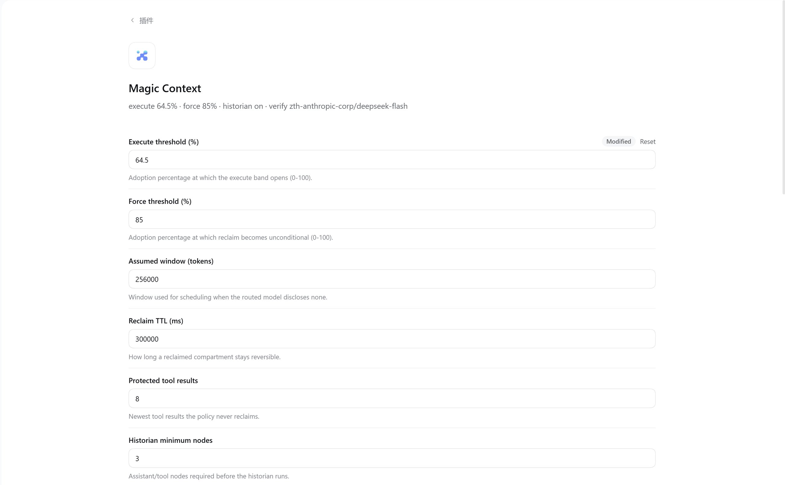
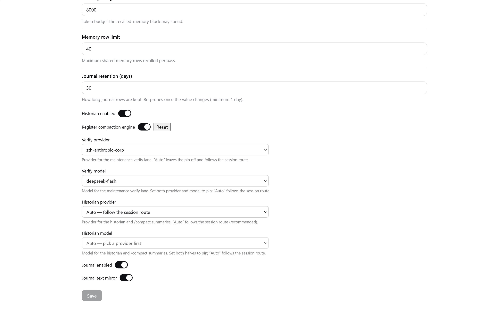
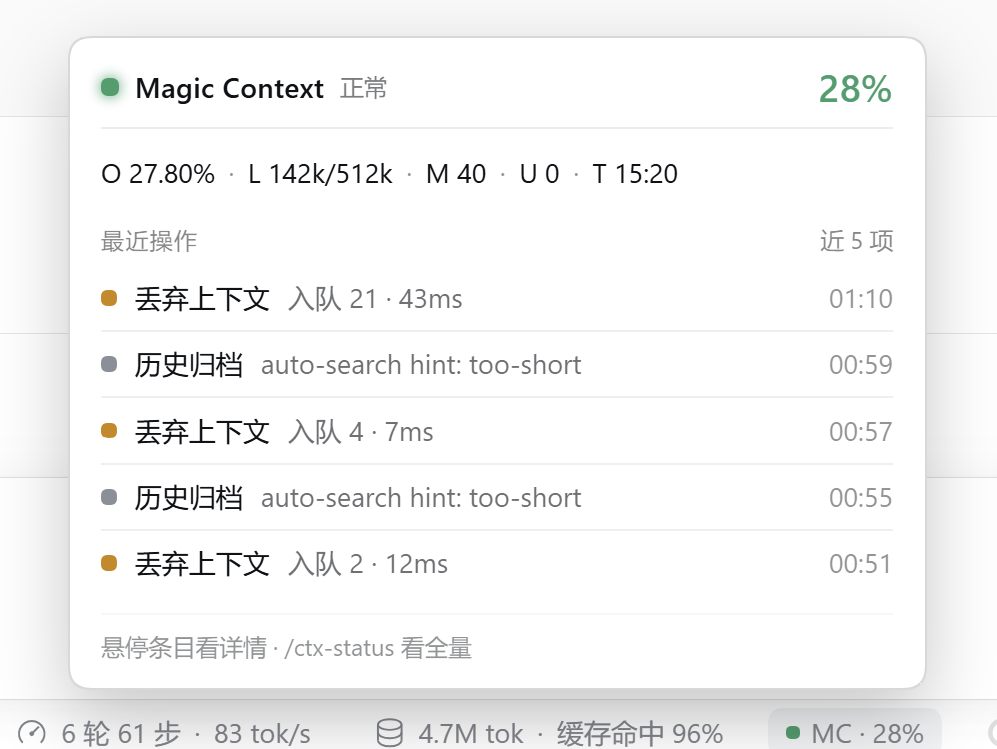

# dsh-plugin-magic-context — Magic Context 的 DeepSeek Harness 适配插件

[](https://github.com/elvisw/dsh-plugin-magic-context/actions/workflows/ci.yml)
[](https://www.npmjs.com/package/@elvisw/dsh-plugin-magic-context)
[](LICENSE)
[](package.json)
[](package.json)

> [English](README.md) | **简体中文**

> 跑过长会话的人都认得这些症状：上个会话弄明白的项目细节，这个会话全忘光，同一个坑再踩
> 一遍；上下文被几十条工具输出撑爆；一压缩，cache 前缀全失效、贵的部分重来一遍。
>
> [Magic Context](https://github.com/cortexkit/magic-context) 的回答：**知识应该沉淀，上下文
> 应该被管理**。会话中提炼的事实沉淀为项目记忆——跨会话复用、全文+本地向量混合检索、经人工
> 审批的机器/组织共享域；同时上下文本身被当作资产经营——工具输出打标回收、需要时原样恢复，
> 被消化的历史变成四层摘要而不是消失。本插件把这套能力完整接到 **DeepSeek Harness（DSH）**
> 桌面端：以 bundle 形态装进 profile，出现在 GUI"插件"页，在运行中的应用里即时开始工作。
>
> 上游跟进已核到 **v0.49.30**（适配器对齐面 0 变动）· 宿主 **0.2.2-rc.1** 实测运行正常 ·
> 状态：**已在真实 DSH Desktop 日常运行**，838 测试用例门禁。仓库历史与出处见
> [NOTICE](NOTICE)；数据目录见[观测与运维](#观测与运维)。

需要 **Node ≥ 22.19** 与 **DSH 0.2.x** 桌面宿主。包内自带编译产物，直接从 npm registry
安装：

```bash
dsh plugin --profile desktop add @elvisw/dsh-plugin-magic-context
```

自 `0.12.0` 起 npm 包名为 `@elvisw/dsh-plugin-magic-context`。如果之前装过上游的 `dsh-plugin-magic-context`，请先移除旧包：两者使用同一个 loader row id（`magic-context-dsh`）。

五分钟上手见[快速上手](#快速上手)；配置、工具与架构见下文各节。

## 快速上手

装好后插件热加载（无需重启）。下一个会话里你会看到：

- 工具结果带上 `§N§` 标签；overlay 里出现**遥测徽标**，显示实时上下文占用，点开是
  指标面板与操作记录。
- GUI「插件」页出现本插件的**设置卡片**。
- `ctx_reduce` / `ctx_expand` / `ctx_memory` 三个工具已注册；项目记忆**默认开启**——
  historian 提炼的事实跨会话沉淀，注入模型读取的位置。

一次对话里的上下文回收（真实参数名）：

```text
你：   ctx_reduce {"drop": "4-7"}      # 四条工具输出不再值这些 token
模型： 已入队 4 项——落地为占位符，发生在下一个回收带
……稍后的对话流里……
[dropped §4§] [dropped §5§] [dropped §6§] [dropped §7§]
你：   ctx_expand {"tag": "5"}         # 等等，§5 里原来是什么？
结果： §5 的原文作为新工具结果返回；§5 占位符保持 dropped
```

唯一需要主动开启的是压缩接管（`registerCompactionEngine`，默认关，见[配置](#配置)）。

## 它做什么

记忆在前、上下文管理在后——前五行为记忆系统，后五行为上下文管理（完整设计见[架构](#架构)与
[PARITY.md](PARITY.md)）：

| 能力 | 机制 |
|---|---|
| **项目记忆（自有语料库）** | 插件自有 SQLite 库（`memories.db`），与上游硬分家——存储不共享、无兼容义务；项目身份自动推导（`git:<root-sha>` / `dir:<hash>`）；注入 m[0] 基线并由 `ctx_memory` 读写；historian facts 自动提升；FTS 0.7 / 向量 0.3 混合检索 |
| **本地向量车道** | MiniLM 向量经内置 onnxruntime-web WASM 本地运行——无原生编译、无 API key；模型下载钉 revision+sha256（双镜像回退），缓存于插件数据目录；检索候选内嵌 + 维护 tick 回填；任何失败 fail-open 降级全文检索 |
| **m[0]/m[1] 记忆基线** | 合成 notice 节点承载冻结基线 + 增量车道（`<new-memories>` / `<memory-updates>` / `<user-profile>`）；每类增量独立水位，**新记忆永不重建缓存前缀**；内容未变则零变更 |
| **全局域 + 用户画像** | 机器 / 组织域：**入队可自动化**（维护 tick、LLM 域分类），**发布永远是人**（审批卡、`/ctx-global approve`）；用户画像 render / collect / review 三开关分离 |
| **维护 tick（MC dreamer 切片）** | 每 30 min：TTL 归档 → 批量 LLM verify（keep / update / archive）→ 向量回填 → 全域候选入队 |
| **可逆上下文回收** | 工具结果打 `§N§` 标签；`ctx_reduce` **只入队**——落地发生在 execute 带内，成为引用原文的 `[dropped §N§]` 占位符；`ctx_expand` 把原文作为新结果返回，占位符保持 dropped。绝不自发打断缓存前缀 |
| **压力调度** | 持久 usage（含 cache 读写）→ 压力分 → execute/defer 决策（65% 阈值、5 min cache TTL、85% 强制带）；`CONTEXT_WINDOW_EXCEEDED` 触发紧急回收 + retry；reduce-guidance 分级引导 |
| **historian（带外摘要）** | 一次 LLM 调用重放真前缀（保 KV cache）→ 四层摘要 p1–p4 + facts/events，**只写 store 不动线缆**；execute 带内发布为 `[compacted §C<n>§]` 范围替换；`/ctx-recomp` 原地重做已压缩历史 |
| **压缩接缝** | `registerCompactionEngine` 可接管 `ctx.compaction`（真实 `compaction/start\|summary\|replace\|end` 协议）；**默认关**，宿主 compaction-basic 保持原位 |
| **界面集成** | 插件页设置卡片（volatile 字段保存即生效）；`shell.overlay` 遥测徽标 + 胶囊面板（实时指标 + 操作记录）；`session-notice` 会话流提示；中英即时切换 |

## 安装

从 npm registry 安装（推荐；包内自带编译产物 `lib/` 与 `vendor/`，无需本地构建）：

```bash
dsh plugin --profile desktop add @elvisw/dsh-plugin-magic-context
```

registry 版本由 tag 推送自动发布（带 npm provenance 签名），发布流程见
[CONTRIBUTING](CONTRIBUTING.md) 的「发布」一节。

### 从源码安装（开发）

```bash
git clone https://github.com/elvisw/dsh-plugin-magic-context
cd dsh-plugin-magic-context
npm install
npm run build     # tsc → lib/（多文件 ESM）+ 浏览器半侧拷贝为 lib/client.js
dsh plugin --profile desktop add <本仓库路径>   # 应用自带 CLI；spec 可以是 Git 地址、本地路径或 registry 版本
```

安装做三件事：profile 里 `pnpm add`（本地路径用 `link:`）、把包名追加进 `dsh.profile.bundles`、
由 loader 组合。**Desktop 带 HMR → 立即热生效**（无需重启，运行中的会话即刻开始打标签）。

- `peerDependencies` 里的 `@deepseek-ai/*` 全部声明为 `"*"`——兼容性预检对任何 DSH 0.2.x 放行；
  运行时真正 import 的宿主包同时列为**精确版本 dependencies**（随包解析，link: 开发安装由本仓
  自己的 node_modules 提供）。
- 运行环境需要 **Node ≥ 22.19**：自有存储基于内建的 `node:sqlite`，无原生模块（桌面宿主是
  Electron RunAsNode 进程，ABI 编译模块不可移植）。
- **工具构造器解析**：`config.defineTool`（宿主注入，树内 glue 用）优先，其次动态
  `import('@deepseek-ai/dsh-tools')`（硬依赖，任何安装形态物理可解析）。二者皆不可用时**响亮
  失败**（挂载中止）——ctx_* 工具是回收标记的唯一入口，不能静默半启动。
- 两种加载模式：**patch-overlay / 文件 URL**（开发期，overlay yml + `config.defineTool` 注入）
  与 **profile 安装**（生产，包名行 + link 依赖）。生产路径即上面的 `dsh plugin add`。

卸载 / 停用：GUI 插件页停用该 bundle（写 profile patch 的 `disabled`），或
`dsh plugin --profile desktop remove @elvisw/dsh-plugin-magic-context`。

## 配置

改配置有两种途径，语义不同（详见[配置界面契约](docs/dsh-plugin-config-ui-contract.md)）：

- **GUI 设置卡片**：暴露 `policy.*`（含 historian 生成上限 / 上限抬升 / 超时）、
  `historianEnabled`、`registerCompactionEngine`、`journal.*`、`maintenance.*`、`historian.*` 等 volatile 字段。
  两组 provider/model **路由钉**（maintenance 的 verify、historian 的生成）优先从**宿主已配置的模型目录**
  （客户端 `remote.session.modelCatalog()`）下拉选择，并带「Auto = 跟随会话路由」与清空；宿主不提供该
  RPC 的 shell 退回纯文本输入（值仍可手填）。写回走 settings
  链路：非 volatile 键原样保留、未触碰的字段不会 materialize 进覆盖行——**保存即生效**
  （host 侧读取一律经 `liveNumber/liveBoolean/liveString/liveRoute` 在决策点现取）。
- **手写 profile 覆盖行**：`config` 是**整体替换**包内 patch 的 config，**不是深合并**。只写
  `memory:` 会把 `registerCompactionEngine: false` 抹掉。手写覆盖时必须把要保留的键一并写出。

bundle 自带配置只有一行：`registerCompactionEngine: false`——保守首装，宿主压缩引擎保持原位
（记忆、回收与 historian 均默认开启）。要接管压缩时：

```yaml
- id: magic-context-dsh
  name: '@elvisw/dsh-plugin-magic-context'
  config:
    registerCompactionEngine: true
- id: compaction-basic
  name: '@deepseek-ai/dsh-compaction-basic'
  disabled: true          # 二者互斥，接管时必须同时禁用宿主引擎
```

配置参考（完整类型见 [src/dsh/config.ts](src/dsh/config.ts)；除注明外均为 profile 覆盖行可写）：

| 组 | 键（默认值） | 说明 |
|---|---|---|
| 总开关 | `enabled` (true) · `registerTools` (true) · `registerStatusCommand` (true) · `sessionNotices` (true) · `reduceGuidance` (true) · `searchHint` (true) | `enabled: false` 保持加载但完全惰性；`sessionNotices` 控制会话流内的管理提示行 |
| 压缩接缝 | `registerCompactionEngine`（代码默认可解析即挂；**bundle 随发 false**）· `compactionBase`（宿主注入基类） | 接管需同时禁用 compaction-basic；pre-step 每步 `reconcileEngine` 动态挂/卸 |
| 压力策略 | `policy.*`：`executeThreshold` (65) · `forceThreshold` (85) · `ttlMs` (5 min) · `assumedContextWindow` (256k) · `protectedToolResults` (8) · `historianTimeoutMs` (120 s) · `historianMaxTokens` (8192，低于会被抬到 8192) · `historianMaxTokensCeiling` (32768) · `baselineTokens` (2000) · `memoryBudgetTokens` (8000) · `memoryLimit` (40) · `forceWaitReadyMs` (0) | 阈值在下一个决策点生效（含 `/ctx-status` 与 compaction engine 路径）。`compartmentGuardMode` / `compartmentEntrantTokens`（发布护栏）已退役，不再是可配置项 |
| historian | `historianEnabled` (true) · `historian.{provider, model}`（**成对钉住**；空 = 跟随会话最后路由） | 带外摘要与 `/compact` 摘要的生成路由；GUI 卡片有「Historian provider/model」下拉（Auto = 跟随会话，推荐）。verify 之外的唯一 LLM 消耗点 |
| 项目记忆 | `memory.{}`：`enabled`（true，0.9.0 起默认开启——`enabled: false` 退出）· `dbPath` · `project`（省略用会话 cwd）· `domainProjects` · `shareCategories` · `autoPromote` (true) · `write` (true) | `write: false` 让 `ctx_memory` 退回只读 |
| 检索 / 向量 | `memory.embedBackfill` (true，查询侧内嵌补分) · `memory.vectorBackfill` (true，维护 tick 回填) · `memory.vectorBackfillLimit` (24 行/tick) | 向量车道任何失败 fail-open 降级 FTS |
| S(t) 衰减 | `memory.scoring.{enabled (true)，alpha (0.4)，beta (0.2)，archiveThreshold (2)，halfLives}` | 统计恒收集；分发缺省 enabled=true 接管排序；profile-JSON only，不进设置卡片 |
| 全局域 | `memory.global.machine.{enabled (true)，excludeProjects，autoStage (true)}` · `memory.global.user.{render (true)，collect (true)，review (true)}` · `memory.global.review.batchLimit` (50) | 分发缺省全开：入队可自动化（≤3 条/pass、≥10 候选待审时暂停），**发布永远是人**；LLM 分类失败 fail-closed |
| 用户画像 | `memory.global.user.{render (true)，collect (false)，review (false)}` | 读 / 收集 / 评审三半独立；写共享库的两个半边默认关 |
| 域解析 | `memory.domains.source` (`adapter` \| `contract`) | `contract` 是对照用的回退杆，不是支持终态 |
| 维护 | `maintenance.{enabled，intervalMs (30 min)，verifyProvider，verifyModel}` | LLM verify 需显式路由（未钉则跟随主对话最新路线）；GUI 卡片可从宿主模型目录下拉选择，Auto = 不钉（两组 pin 同款选择器） |
| 观测 | `journal.{enabled (true)，level (info)，retentionDays (30)，mirror (true)}` | level/mirror 对下一条写入生效；挂载时就是 off 的 journal 运行中打开需重启；`retentionDays` 有 `min(1)` 下限防误剪。§N§ tag 行没有按天 TTL；本适配器当前没有自动的消息/会话删除路径 |

## 工具与命令

Agent 工具（挂载时注册；`registerTools: false` 可关）：

| 工具 | 作用 |
|---|---|
| `ctx_reduce` | 解析 MC 范围语法（`"3-5,8"`）→ **只入队**；落地是有价 bust，等待回收带，绝不自发 |
| `ctx_expand` | 按 `tag`（单个，正式）、已弃用的 `tags` 别名，或 `message`（当前会话中已 drop 项的 DSH 日志事件 seq；不接受 `[compacted §C…§]` 节点），从持久化日志**把原文作为新结果返回**；旧占位符及其已用尽的 tag 保持原位。tag 是主入口，message 是备用定位，不是通用历史浏览器；原始事件已不存在时不承诺恢复 |
| `ctx_memory` | 共享记忆库的读写口。读：`list` / `search` / `get`；写：`write` / `update` / `archive` / `merge`（与 MC 相同的规范化内容哈希、mutation log 与 authority 守卫全程在环）；`review_global`（把机器/组织域候选逐条弹成审批卡，批准才发布）；`promote`（单条项目记忆即时入池弹卡，无复现门槛的人工通道）。每个动作可带 `project`（绝对路径或 git 根）操作其它项目 |

斜杠命令（`registerStatusCommand: false` 关闭整个斜杠命令面）：

| 命令 | 作用 |
|---|---|
| `/ctx-status` | 压力 / 决策 / 回收台账 / compartments / 基线 / 策略 |
| `/ctx-flush` | 把当前会话已排队的 `ctx_reduce` 标记为下一次消息强制落地；回执 requested / already marked / pendingNext；不启动 historian、recomp、摘要或模型调用 |
| `/ctx-recomp` `all` \| `last:<n>` \| `<startSeq>-<endSeq>` | 重跑 historian 并**原地替换** store 里的摘要（区间按 compartment 吸附、绝不切分；身份与已落地占位符不变，下一趟 pre-step 重建基线） |
| `/ctx-profile` `confirm` \| `reject` \| `retire` | 用户画像候选的确认 / 拒绝 / 退休；晋升进共享 profile 在下一维护 tick 发生 |
| `/ctx-global` `add` \| `remove` \| `status` \| `promote` \| `approve` \| `reject` | 全域成员管理与候选审批的人工通道（与审批卡走同一 gate→publish 路径，`source_type=user`） |

## 界面与遥测

两个界面能力都靠同一个浏览器半侧（`src/client/index.js`，构建时原样拷为 `lib/client.js`）：

- **插件页设置卡片**：上文 volatile 配置项的可视化编辑，保存即生效（见"配置"一节）。

  

  

- **`shell.overlay` 遥测徽标 + 胶囊面板**：收起态显示占用百分比；面板里是两行指标、节拍与
  **实时操作记录**（最多 12 条，相邻同操作折叠 `×N`）：🧠 写入记忆 · 🔎 加载记忆 · 🗑️ 回收入队 ·
  🧭 恢复原文 · ✂️ 压缩上下文 · 🗑️ 丢弃上下文 · 🧭 归档已存 · 🧰 维护巡检 · ⚠️ 失败。
  点击面板/徽标之外、按 Esc、窗口失焦即关闭。

  
- 数据来自本插件自己的 HTTP 路由（harness 的 Remote 事件白名单是编译期常量，第三方 bundle 的
  受支持口子是 `ctx.webServer.register`）：
  - `GET /mc-telemetry/summary` — 一次性快照（适配器 / 项目 / 健康状态 + 最近事件）
  - `GET /mc-telemetry/events` — SSE 实时尾
- **安全**：路由仅 loopback、无 token 鉴权，因此**只输出计数与单行摘要**——不含消息正文、
  不含文件路径、不含凭据。
- **多语言**：浏览器侧 `magic-context` 命名空间字典（zh/en），设置 → 通用切换即时生效、无需刷新；
  写进会话流、模型可见的 `session-notice` 保持英文常量（避免同会话中途换语言造成 cached prefix
  抖动）。机制见[主界面遥测契约](docs/dsh-plugin-ui-telemetry-contract.md)。

## 观测与运维

Desktop **不持久化 `ctx.logger` 输出**，所以插件把决策与结果写进自己的 append-only journal：

- `~/.local/share/cortexkit/magic-context-dsh-poc/dsh-magic-context.db` → `journal` 表
  （结构化，可 SQL 查询）
- `~/.local/share/cortexkit/magic-context-dsh-poc/activity.log` → 单行文本镜像
  （`tail`/grep 友好，超 5 MiB 自动轮转为 `.1`）

**隐私**：消息正文**永不记录**。只记计数、标签号、token 估算、原因与耗时；字符串截断 300 字符、
数组上限 20 项（`redactData` 兜底）。

journal 覆盖（按组）：生命周期（`boot` / `config-drift` / `session-first-seen`）；回收与压缩
（`pass` —— execute 全量记录，含 **tokensBefore→After 净回收证明** 与 defer 原因、`drop-landed`、
`compartment-published`/`-recomp`/`-guard`、`force-path`、`emergency-reclaim`、`context-pressure`）；
historian 与基线（`historian` —— 含 start/done/failed 配对与 LLM 用量、`baseline`、`session-notice`、
`wire-repair`）；记忆（`memory-recall` / `profile-recall` / `memory-promote` / `memory-stats` /
`vector-lane` / `search-hint` / `project-drift` / `global-review`）；维护（`maintenance`）；
工具与引擎（`tool-call` / `engine` / `error` —— 所有 fail-open 吞掉的异常）。

### 运维命令

```sh
npm test               # vitest run
npm run gate           # 全门禁：typecheck + 套件 + build + 验收 + 记忆审计 + records
npm run doctor         # 只读健康报告：corpus fence / 事件车道心跳 / 悬空 run / embedding 车道

node scripts/mc-report.mjs --days 7 [--json] [--session <id>]   # journal 复盘报告
node scripts/mc-acceptance.mjs [--hours 72 --json]              # 语料库验收，失败 exit 1
npm run phase          # 阶段门：跑某一阶段的套件并给出裁决与盲区
```

复盘报告含：库与状态、按 kind/按天计数、关键指标（execute/defer 比例与原因分布、净回收、
historian 失败率与耗时、紧急回收、工具调用）、最近事件明细与健康提示（"窗口内没有 execute
pass" / "historian 从未运行" / "存在 error" / "journal 最新事件超过 24h" 等）。

`scripts/` 专项工具：检索权重 A/B（`retrieval-eval`）、S(t) 排序离线 diff（`score-diff`）、
稀释与 fold 仪表（`report-dilution`）、域命中统计（`report-hits`）、historian 失败分类
（`report-classify`）、向量模型预检（`embedder-precheck`）、参考种子重建（`npm run build:seeds`）、
面板分类校验（`mc-records-check`）、多语言检查（`npm run check:i18n`）。

## 架构

```
src/
  dsh/     # ← 全包唯一允许 import @deepseek-ai/* 的目录（防腐层）。
           #    事件名、payload 形状、surface 词汇表全部收拢在这里，
           #    DSH 升级只改这个目录。
  core/    # 中性逻辑与存储：policy/stores/journal/memory-*/domains。
           #    不依赖 DSH。
  client/  # 浏览器半侧（设置卡片 + 遥测徽标），纯 JS，
           #    构建时原样拷为 lib/client.js。
  index.ts # 组合根：boot probe（fail-loud）→ 接缝监听 → 中性存储。
```

隔离纪律（DSH 处于 developer preview，破坏性变更预期之内；这就是本包的结构策略）：

- **能力探测 fail-loud**：`probeDshSeams` 启动期校验接缝可用性，不可用即抛错，绝不静默假装
  在管理上下文；
- **版本 fence**：适配器库 schema 链当前 **v11**（前向迁移，库比新即拒开）；**自有语料库**
  `memories.db` 版本线继承 **v95** 起点（2026-10-13 切换，续号归本插件；`MEMORY_SCHEMA_MAX_VERSION`
  守自有迁移线），超出即读路径拒绝、写路径转只读并响亮告警；
- **测试即探针**：集成测试同时是接缝契约测试——DSH 升级后重跑，破坏点精确定位到 `src/dsh/`；
- **双库结构**：
  - **适配器库** `~/.local/share/cortexkit/magic-context-dsh-poc/dsh-magic-context.db`
    （tags / usage / pending_drops / compartments / baseline / domains / queues / journal…，
    schema v11）；
  - **自有语料库** `~/.local/share/cortexkit/magic-context-dsh-poc/memories.db`
    （项目记忆 + 全域行 + 画像 + 向量；legacy `context.db` 已封存不读——2026-10-13 硬切换，
    与上游只做功能跟进、无存储兼容义务）；
- **上游对齐账本**：与 OpenCode / Pi 两个上游适配器的逐条有效行为对齐与刻意差异见
  [PARITY.md](PARITY.md)（aligned / host-imposed / intentional 三种裁决，每条引用宿主文件）。

## 文档索引

**契约类**：[记忆写契约](docs/dsh-plugin-memory-write-contract.md) ·
[记忆提升契约](docs/dsh-plugin-memory-promotion-contract.md) ·
[记忆验收](docs/dsh-plugin-memory-acceptance.md) ·
[配置界面契约](docs/dsh-plugin-config-ui-contract.md) ·
[主界面遥测契约](docs/dsh-plugin-ui-telemetry-contract.md) ·
[升级跟随](docs/dsh-plugin-upgrade-followup.md) ·
[hooks 覆盖](docs/dsh-plugin-hooks-coverage-2026-10-08.md)

**设计决策**：[移植可行性（接缝地图）](docs/dsh-port-feasibility-2026-10-06.md) ·
[平台接管与全域](docs/dsh-plugin-platform-takeover-and-global-domains-2026-10-09.md) ·
[dreamer 向量决策](docs/dsh-plugin-dreamer-vector-decision-2026-10-08.md) ·
[记忆机制清单](docs/memory-mechanisms-inventory-2026-10-09.md) ·
[上游源码分析](docs/upstream-source-analysis-2026-10-09.md) ·
[全域来源调查](docs/global-domain-source-finding-2026-10-10.md) ·
[记忆架构挑战](docs/memory-architecture-challenge-2026-10-10.md)

**复盘与运行**：[测试设计审计](docs/dsh-plugin-test-design-audit-2026-10-07.md) ·
[运维手册](docs/dsh-plugin-operations-runbook-2026-10-10.md) ·
[surface 写审计](docs/dsh-surface-write-audit-2026-10-09.md) ·
[本地向量运行时审计](docs/local-embedding-runtime-audit-2026-10-15.md)

**报告**：[dreamer token 用量](docs/reports/dreamer-token-usage.md) ·
[记忆方案对比](docs/reports/memory-solutions-comparison.md)

## 已知边界

- historian 的触发与预算用 **chars/4 估算**，不是真 tokenizer（检索向量的分词是真
  tokenizer）；四层摘要在**一次调用**内产出（MC 是跨调用累积）；
- `review_global` 审批卡必须由 agent 轮内触发；headless 无审答器时明确拒绝、零状态变更；
- 挂载时就是 off 的 journal，运行中打开需要重启（其余 journal / 阈值改动均即时生效）；
- Desktop 不持久化 harness logger——可观测性完全由自记 journal 承担。

## 贡献

- 贡献指南：[CONTRIBUTING.md](CONTRIBUTING.md)（环境、代码约定、PR 流程）
- 安全漏洞请走私密报告通道：[SECURITY.md](SECURITY.md)
- 行为准则：[CODE_OF_CONDUCT.md](CODE_OF_CONDUCT.md)
- 变更记录：[CHANGELOG.md](CHANGELOG.md)

本仓库以 npm 为唯一包管理器（`package-lock.json` 为准），CI 在 Node 22.x / 24.x 上跑
typecheck → test → build → check:i18n。

## 出处与许可

### 与上游 DSH 适配器的差异

本仓库是 [`wk544863858/dsh-plugin-magic-context`](https://github.com/wk544863858/dsh-plugin-magic-context)
（npm 包 `dsh-plugin-magic-context`）的 fork。上游最后一个公开发布是 `dsh-plugin-magic-context@0.11.2`
（2026-11-11）；本 fork 自 `0.12.0` 起以 `@elvisw/dsh-plugin-magic-context` 发布，版本与 tag 归本 fork。
上游仓库和上游 npm 包仍由原维护者维护，本 fork 不修改它们。

相对上游 `0.11.2`，`0.12.0` 的主要差异：

- **恢复语义**：`ctx_expand` 不再原地改写占位符，而是读取持久化的原始 `tool/result`，作为新的工具结果返回并分配新 tag；旧占位符保持不变，旧 tag 仍是 dropped，再次 `ctx_reduce` 是 no-op（`already dropped`）。这是 breaking change。
- **Historian 之后仍可读原文**：`ctx_expand` 新增 `message` 定位，接受当前会话的 DSH log event seq（包括被 Historian shadow 的原始 `tool/result`）；不重跑原工具、不改写摘要或 compartment。
- **手动 flush**：新增 `/ctx-flush`，只把当前会话已 pending 的 drop 标记为下一次 preStep 落地；不启动 Historian、recomp、摘要或模型调用。
- **持久 drop 状态**：`ctx_reduce`/`ctx_expand` 以 `pending_drops` 的 `none`/`pending`/`landed` 状态判定，而不是依赖当前 surface 上是否还有占位符；旧 tag 在 restore 后不会再显示假的 “Queued”。
- **tag 保留策略**：移除挂载时的 30 天 tag prune、`tags.retentionDays` 配置与 `AdapterStores.pruneTags`；旧 profile 里的该键保留但被忽略，且每进程最多告警一次。
- **schema 与包名**：插件数据库升到 v11（`pending_drops.flush_requested`，v10 自动迁移）；npm 包名改为 `@elvisw/dsh-plugin-magic-context`，但 loader row id `magic-context-dsh`、settings namespace 与插件数据目录 `magic-context-dsh-poc` 不变。

因为 row id 相同，上游 `dsh-plugin-magic-context` 与本 fork **不能并排安装**；升级前先移除旧包。本 fork 只保证自己的插件行为与数据迁移，不承诺与上游 0.11.x 的 UX/API 长期兼容；兼容语义以原版 `cortexkit/magic-context` 为参照，DSH 仍是宿主。

### 版权与第三方

- **上游 DSH 适配器**（`wk544863858/dsh-plugin-magic-context`，npm `dsh-plugin-magic-context@0.11.2`，MIT，
  Copyright (c) 2026 wukai — the DeepSeek Harness adapter in this repository）：本 fork 的直接上游。
  本 fork 的修改部分 Copyright (c) 2026 elvisw，同样以 MIT 发布。
- **magic-context**（MIT，Copyright (c) 2025 Ufuk Altinok — magic-context）：本仓库的衍生来源。抽取自上游 tag
  v0.46.0（`651c105a9`）；适配器自有提交从本地 checkout `dsh` 分支的 `e34eda955`
  （2026-10-08）原样重放。
- **DeepSeek Harness**（MIT）：以依赖消费，不含在内。代码针对 0.2.1-rc.1 编写
  （checkout `1600d8a1e`，npm 协调 dist-tag `next`；注意这些包的 `latest`
  标签落后一个发布线，精确钉版以 devDependencies 为准）。
- 内嵌第三方：`vendor/onnx/`（onnxruntime-web WASM 子集，MIT © Microsoft）、
  `tests/helpers/mock-adapter.ts`（DSH 测试树原样内嵌）。明细见 [NOTICE](NOTICE)，
  许可见 [LICENSE](LICENSE)。
