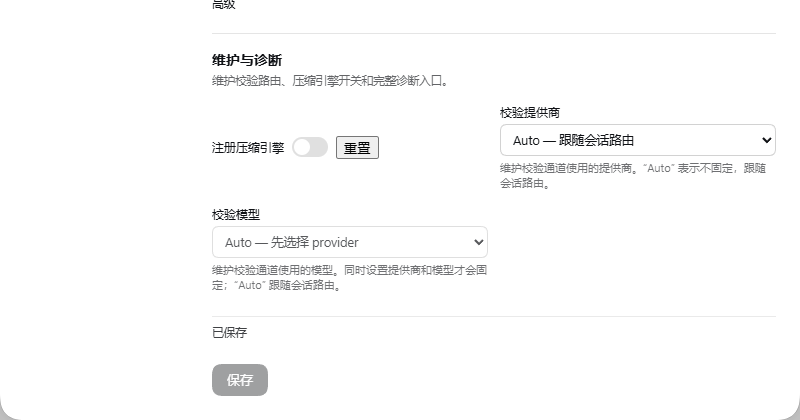
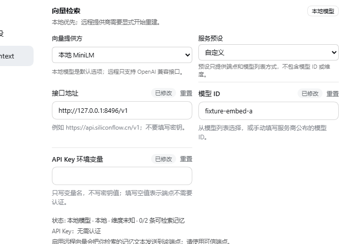
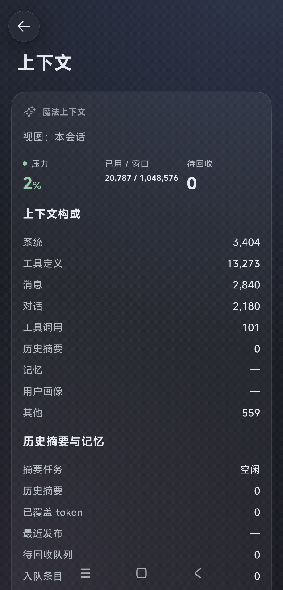
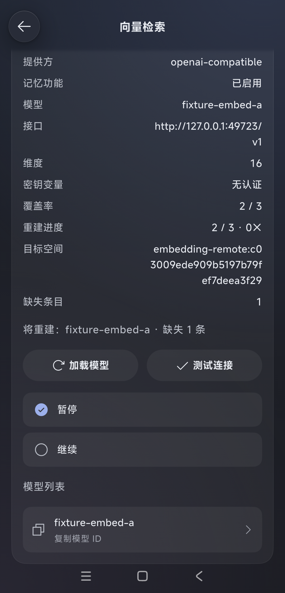
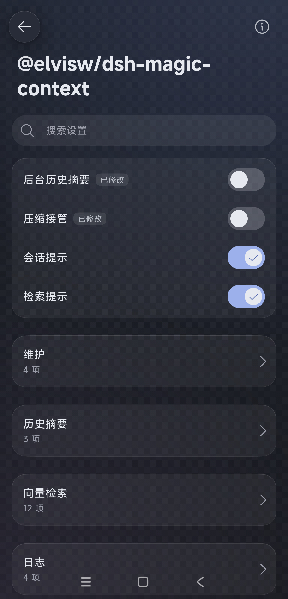

# Magic Context for DeepSeek Harness — elvisw fork

[](https://github.com/elvisw/dsh-plugin-magic-context/actions/workflows/ci.yml)
[](https://www.npmjs.com/package/@elvisw/dsh-magic-context)
[](LICENSE)
[](package.json)
[](package.json)

> [English](README.md) | **简体中文**

跑过长会话的人大概都遇过这几件事：上个会话弄明白的项目细节，这个会话全忘光，同一个坑再踩一遍；上下文被几十条工具输出撑爆；一压缩，缓存前缀全失效，贵的那部分重来一遍。

[Magic Context](https://github.com/cortexkit/magic-context) 处理的就是这两件事：让知识沉淀下来，让上下文被管起来。

会话里提炼出的事实存成项目记忆，跨会话可用。检索走全文加本地向量，两条通道一起给结果。需要共享时走人工审批的机器域和组织域。上下文这边，工具输出可以打标签回收，要用时把原文取回；被消化的历史收成摘要，而不是直接丢掉。

本插件把这套能力接到 **DeepSeek Harness（DSH）** 上。以 bundle 形式装进 profile，在运行中的应用里直接开始工作。

上游跟进已核到 v0.49.30。宿主 0.2.2-rc.1 上实测运行正常，日常在 Web profile 里用着。仓库历史和出处见 [NOTICE](NOTICE)。
## 安装

需要 Node ≥ 22.19，以及带 Web 客户端的 DSH 0.2.x 宿主（桌面应用或 `web` profile）。

```bash
dsh plugin --profile web add @elvisw/dsh-magic-context
```

包内自带编译产物，装完重启 profile 就能用。该 profile 开了 HMR 的话会热加载。

从 0.18.0 起，Android 的 dsh-go 1.1.0 用同一个包，见 [Android 一节](#android)。不需要 Flutter 构建，也没有第二个包。

> **包名。** npm 上无 scope 的 `dsh-magic-context` 是另一位维护者的独立实现，不是这个 fork，也不是它的上游。本 fork 只以 `@elvisw/dsh-magic-context` 发布，安装命令里的 `@elvisw/` 不能省。

如果你之前装过 `@elvisw/dsh-plugin-magic-context`（0.12.x）或上游的 `dsh-plugin-magic-context`，先卸掉旧包。三者用同一个 loader row id（`magic-context-dsh`），装在一起只会加载一行，设置页可能直接消失。0.12.x 升级还要迁移一次 profile patch 里的包名，脚本和步骤在 [独立包名与发布](docs/independent-package-release.md)。

可选的压缩接管只对 flat/headless 组合有效，**在 Web 和桌面端不起作用**，原因见[配置参考](docs/configuration.md)。

## 装完会看到什么

- 工具结果带上 `§N§` 标签。overlay 里多一个遥测徽标，显示实时上下文占用，点开是 token 构成和操作记录。
- 设置里多一个顶层「Magic Context」页。旧的「插件」页卡片已经移除，宿主如果没有 `settings.section` 槽位，就没有配置入口了。
- 三个工具注册好了：`ctx_reduce`、`ctx_expand`、`ctx_memory`。项目记忆**默认开着**，historian 提炼的事实会自动沉淀。

一次真实的回收长这样：

```text
你：   ctx_reduce {"drop": "4-7"}
模型： 已入队 4 项——落地为占位符，发生在下一个回收带

…… 稍后 ……
[dropped §4§] [dropped §5§] [dropped §6§] [dropped §7§]

你：   ctx_expand {"tag": "5"}
结果： §5 的原文作为新工具结果返回；§5 占位符保持 dropped
```

## 它做什么

| 能力 | 说明 |
|---|---|
| **项目记忆** | 插件自己的 SQLite 库，与上游存储完全分开。项目身份从 git 根自动推导。模型通过 `ctx_memory` 读写。 |
| **本地向量检索** | 包内 WASM 跑 MiniLM，不需要 API key，不需要编译原生模块。模型按哈希钉住，缓存在插件数据目录。失败就退回全文检索，不影响使用。 |
| **记忆基线** | 冻结的基线加增量车道。新记忆不会触发缓存前缀重建；内容没变就零变更。 |
| **全局域与用户画像** | 入队可以自动，**发布永远要人点**。画像的读取、收集、评审三个开关分开。 |
| **维护 tick** | 每 30 分钟跑一轮：TTL 归档、批量核验、向量回填、全域候选入队。 |
| **可逆回收** | 工具结果打标签，`ctx_reduce` 只入队，真正落地发生在下一个回收带。`ctx_expand` 把原文当新结果返回。 |
| **压力调度** | 按持久化的 usage 算压力，65% 阈值、85% 强制带。窗口超限时触发紧急回收并重试。 |
| **历史摘要** | historian 重放真前缀（保住 KV cache），产出四层摘要和事实。只写存储不动线缆，发布发生在 execute 带内。 |
| **压缩接缝** | 可以接管宿主的压缩引擎，但只对 flat/headless 有效，默认关闭。 |
| **设置页** | 顶层分区页，五个分区加四项摘要。字段中英文即时切换。 |
| **遥测面板** | token 构成条、估算消息构成、历史摘要/记忆/队列/维护分区。宿主没上报的值显示 `—`，不写成 0。 |

## 工具

挂载时注册。`registerTools: false` 可以关掉。

| 工具 | 作用 |
|---|---|
| `ctx_reduce` | 解析范围语法（`"3-5,8"`）并入队。落地是有代价的缓存失效，所以要等回收带，不会自己触发。 |
| `ctx_expand` | 按 `tag`、`message`（会话内日志事件 seq），或一段 `start`/`end` 区间取回原文。取回的是新的工具结果，旧占位符和旧 tag 保持原样。 |
| `ctx_memory` | 记忆的读写口。读用 `list` / `search` / `get`，写用 `write` / `update` / `archive` / `merge`。另有 `review_global` 处理共享域审批，`promote` 走单条即时入池。每个动作都能带 `project` 操作别的项目。 |

## 命令

`registerStatusCommand: false` 关掉整个命令面。

| 命令 | 作用 |
|---|---|
| `/ctx-status` | 压力、决策、回收台账、compartments、基线、策略 |
| `/ctx-flush` | 把已排队的回收标记为下一次消息强制落地。不启动 historian，不调模型。 |
| `/ctx-recomp` | 重跑 historian，原地替换存储里的摘要 |
| `/ctx-wrapup` | 为下一次 pre-step 排队一次手动压缩，保留最新 N 条（默认 20） |
| `/ctx-profile` | 用户画像候选的确认、拒绝、退休 |
| `/ctx-global` | 全域成员管理与候选审批 |

对照 cortexkit v0.49.59，`/ctx-dream` 和 `/ctx-embed` 没有注册。前者需要完整的 dreamer 任务集，后者的目标是会话历史、记忆和 git 提交，而本适配器的向量只覆盖记忆。逐条矩阵见 [PARITY.md](PARITY.md#command-surface-upstream-commands-checked-at-v04959)。

## 设置

设置页在**设置 → Magic Context**。五个分区、四项摘要、跳转行和高级折叠，宿主底栏上方有一条纯文本状态条。旧「插件」页卡片已移除。






常用几项：

- **记忆开关。** 默认开。要退出就在 profile 补丁里写 `memory.enabled: false`。
- **Historian 路由。** 可以钉死 provider 和 model，也可以留空跟随会话。推理强度从宿主模型列表里选。
- **向量检索。** 默认本地 MiniLM。要换 OpenAI 兼容的嵌入 API（比如硅基流动），在这个分区选预设、加载模型、测试连接。密钥只写不读，存进宿主凭据库，卡片只显示「已配置 / 未配置」。

完整键表和默认值在[配置参考](docs/configuration.md)。手写 profile 覆盖行时注意 `config` 是**整体替换**，不是深合并。

### 遥测徽标

composer 上方有个胶囊，收起时显示实时压力、token 对、Historian 状态和回收队列（`H` / `Q<n>`）。窗口窄的时候切成图标。

点开是面板：

- **宿主 token 构成条**，分成系统 / 工具定义 / 消息三段，旁边是绝对 token 对（`11.8k / 1M`）。
- **估算的消息构成**，分成对话 / 工具调用 / 压缩段 / 记忆 / 用户画像 / 其他。没有估算来源的行直接不显示，不写成 0。
- **历史摘要、记忆、回收队列、维护、可回收、警告**几个分区。
- **实时操作记录**，最多 12 条，相邻同类折叠成 `×N`。

打开时焦点锁在面板内。点外面、按 Esc、窗口失焦或点关闭按钮都能关，焦点会还回胶囊。面板底部有 `/ctx-status` 入口。

## Android

同一个 npm 包为 **Android dsh-go 1.1.0** 提供原生面板。选**手机本机引擎**。

市场条目可用后，在「插件市场 → 适配 DSH Go」里搜 `@elvisw/dsh-magic-context`。搜不到就在 App 的本机终端装准确版本，然后重启引擎：

```bash
dsh plugin --profile web add @elvisw/dsh-magic-context@0.18.0
```

不用改 Flutter，也不用拆第二个包。只有找到桥接时，宿主半侧才注册状态条和面板；没有桥接的桌面端和 Web profile 照常加载。

- **输入框状态条。** 和桌面胶囊同源的摘要，比如 `上下文 62% · 待回收 3`。生成回复时让位给宿主。
- **上下文面板。** 从对话打开时严格按那个会话取数，从「全部功能」打开时标成全局视图。缺失值显示 `—`，不写成 0。手机端不重新统计 token。
- **向量检索面板。** 显示 provider、模型、探测维度、覆盖率、重建进度。可以加载模型 ID、测试连接、确认后开始重建、暂停继续。打开面板或保存配置都不会自动探测或重建。





远程向量的密钥在桌面或 Web 设置页录入。原生设置页声明了同一组 role，但 dsh-go 1.1.0 的桥接还没把凭据引用传给 App，所以原生密钥输入框现在是禁用状态，见 [dsh-go issue #1493](https://github.com/ccch1mneyyy/dsh-Go/issues/1493)。在这之前手机端用本地 MiniLM 就行，不需要密钥。

### 手机上验到哪一步

2026-11-18 用**已发布的 0.18.0 包**在同一台手机上跑通了完整的本地向量链路：三条记忆由维护 tick 回填成 384 维向量，`ctx_memory action=search` 对同时命中关键词和向量的行返回 `match=hybrid`，对只有向量能找回的行返回 `match=semantic`，引擎重启后共享空间门禁报告 `parity: 1`。详见 [T25 报告](_bmad-output/initiative-dsh-magic-context/acceptance-android-dsh-go-2026-11-18-t25-local-vector/acceptance-report.md)。

更早的 T23 验收跑在预发布候选上，覆盖真实记忆写入检索、原生面板、配置和重启后检索，嵌入用的是 16 维模拟服务，不是 SiliconFlow。

还没测的：手机英文界面、iOS、长历史吞吐、真实厂商流量、中文关键词检索。

## 已知限制

- historian 的触发和预算按字符数除以 4 估算，不是真 tokenizer。检索向量那条路用的是真 tokenizer。
- 四层摘要在一次调用内产完，上游是跨调用累积。
- 中文关键词检索很弱。FTS5 的 `porter unicode61` 不切分中文，整段连续汉字算一个 token，所以中文查询基本只能靠向量通道。这是上游既有行为。
- `review_global` 的审批卡必须由 agent 在轮内触发。headless 没有应答器时会明确拒绝，不改任何状态。
- 挂载时就是关的 journal，运行中打开需要重启。
- 桌面端不持久化宿主 logger，可观测性完全靠插件自己记的 journal。
- 压缩接管只对 flat/headless 有效。

## 观测与排障

宿主不持久化 `ctx.logger` 的输出，所以插件把决策和结果写进自己的 journal：

- `~/.local/share/cortexkit/magic-context-dsh-poc/dsh-magic-context.db` 的 `journal` 表，结构化，可以 SQL 查
- 同目录的 `activity.log`，单行文本镜像，超过 5 MiB 自动轮转

消息正文永远不记录。只记计数、标签号、token 估算、原因和耗时。字符串截断 300 字符，数组上限 20 项。

```sh
npm run doctor         # 只读健康报告
node scripts/mc-report.mjs --days 7 [--json]   # journal 复盘
node scripts/mc-acceptance.mjs [--hours 72]    # 语料库验收，失败退出 1
```

复盘报告里有 execute/defer 比例、净回收、historian 失败率和耗时、紧急回收、工具调用统计，以及「窗口内没有 execute pass」这类健康提示。

完整 journal 分类见[架构文档](docs/architecture.md)。

## 文档

**当前维护的**

- [配置参考](docs/configuration.md)——全部配置键、默认值和远程向量细节
- [架构与内部结构](docs/architecture.md)——目录、双库、存储与检索引擎、组件地图
- [设置界面契约](docs/dsh-plugin-settings-ui-contract.md)（英文）——设置页的宿主接缝与文案规则
- [运维手册](docs/dsh-plugin-operations-runbook-2026-10-10.md)——日常检查、阈值、故障处置
- [升级跟随](docs/dsh-plugin-upgrade-followup.md)——重新对齐流程，§1 是历史基线
- [独立包名与发布](docs/independent-package-release.md)——包身份、迁移、发布流程
- [PARITY.md](PARITY.md)——与上游 OpenCode / Pi 适配器的逐条对齐

**历史资料**

以下只作溯源保留，不是当前保证，每份文件开头都有自己的状态说明和证据基线：

[记忆写契约](docs/dsh-plugin-memory-write-contract.md)、[记忆提升契约](docs/dsh-plugin-memory-promotion-contract.md)、[记忆验收](docs/dsh-plugin-memory-acceptance.md)、[配置界面契约](docs/dsh-plugin-config-ui-contract.md)、[主界面遥测契约](docs/dsh-plugin-ui-telemetry-contract.md)、[hooks 覆盖](docs/dsh-plugin-hooks-coverage-2026-10-08.md)、[移植可行性](docs/dsh-port-feasibility-2026-10-06.md)、[平台接管与全域](docs/dsh-plugin-platform-takeover-and-global-domains-2026-10-09.md)、[dreamer 向量决策](docs/dsh-plugin-dreamer-vector-decision-2026-10-08.md)、[记忆机制清单](docs/memory-mechanisms-inventory-2026-10-09.md)、[上游源码分析](docs/upstream-source-analysis-2026-10-09.md)、[全域来源调查](docs/global-domain-source-finding-2026-10-10.md)、[记忆架构挑战](docs/memory-architecture-challenge-2026-10-10.md)、[域命名决定](docs/domain-naming-work-global-2026-10-25.md)、[测试设计审计](docs/dsh-plugin-test-design-audit-2026-10-07.md)、[surface 写审计](docs/dsh-surface-write-audit-2026-10-09.md)、[本地向量运行时审计](docs/local-embedding-runtime-audit-2026-10-15.md)、[上游跟进 v0.46.0 → v0.49.30](docs/upstream-followup-2026-10-30.md)、[/ctx-flush 研究交接](docs/research-handoff-ctx-flush-2026-11-11.md)。

## 参与

- [CONTRIBUTING.md](CONTRIBUTING.md)：环境、代码约定、PR 流程
- [SECURITY.md](SECURITY.md)：安全问题走私密通道
- [CHANGELOG.md](CHANGELOG.md)：变更记录

本仓库以 npm 为唯一包管理器，以 `package-lock.json` 为准。CI 在 Node 22.x 和 24.x 上跑 typecheck、测试、构建和 i18n 检查。

## 出处与许可

### 和上游 DSH 适配器的差异

本仓库是 [`wk544863858/dsh-plugin-magic-context`](https://github.com/wk544863858/dsh-plugin-magic-context)（npm `dsh-plugin-magic-context`）的 fork。上游最后一个公开发布是 `dsh-plugin-magic-context@0.11.2`（2026-11-11）。本 fork 从 `0.12.0` 到 `0.12.3` 以 `@elvisw/dsh-plugin-magic-context` 发布，`0.13.0` 起改成 `@elvisw/dsh-magic-context`。版本和 tag 归本 fork，上游仓库和 npm 包仍由原维护者维护。

相对上游 0.11.2，累计到 0.18.0 的主要差异：

- **恢复语义改了，这是 breaking change。** `ctx_expand` 不再原地改写占位符，而是读出持久化的原始工具结果，作为新结果返回并分配新 tag。旧占位符保持不动，旧 tag 仍是 dropped，再次回收它是 no-op。
- **historian 之后仍能读原文。** `ctx_expand` 新增 `message` 定位，接受会话日志事件 seq，包括被 historian 挡住的原始工具结果。不重跑工具，不改摘要。
- **新增 `/ctx-flush`。** 只把已排队的回收标记为下一次 pre-step 落地，不启动 historian、recomp 或模型调用。
- **回收状态持久化。** 用 `pending_drops` 的 `none` / `pending` / `landed` 判定，不看当前 surface 上还有没有占位符。旧 tag 取回后不会假装还在排队。
- **tag 不再按天清理。** 移除了挂载时的 30 天 prune 和 `tags.retentionDays`。旧 profile 里留着的键会被忽略，每进程最多告警一次。
- **设置界面重做。** 只注册顶层 `settings.section`，中英文案即时切换，推理强度从宿主模型列表读取。GUI「插件」页的卡片已移除，缺 `settings.section` 的旧宿主没有配置入口了。
- **遥测 v2。** 新增 token 构成条、估算消息构成、历史摘要/记忆/队列/维护/可回收/警告分区。宿主没上报的值显示 `—`、`空`、`尚未运行`，不伪造 0。
- **插件库 schema 到 v11**，带 `pending_drops.flush_requested`，v10 自动迁移。
- **改名不做数据迁移。** 0.12.x 的 profile patch 里还写着旧包名，DSH loader 同时匹配 `id` 和 `name`，不匹配就整行跳过，所以打开设置前要用 `tools/migrate-profile-package-name.mjs --patch <cordis.patch.yml>` 迁一次。迁完记忆、journal、schema 和自定义 `dataDir` 路径都不变。

row id 相同，所以上游包、0.12.x 的 fork 包和本包**不能共装**，升级前先卸旧的。

本 fork 只保证自己的插件行为和数据迁移，不承诺与上游 0.11.x 的 UX/API 长期兼容。兼容语义以原版 `cortexkit/magic-context` 为参照，DSH 仍是宿主。

### 版权与第三方

- **上游 DSH 适配器**：`wk544863858/dsh-plugin-magic-context`，npm `dsh-plugin-magic-context@0.11.2`，MIT，Copyright (c) 2026 wukai。本仓库的直接上游。本 fork 的修改部分 Copyright (c) 2026 elvisw，同样 MIT。
- **magic-context**：MIT，Copyright (c) 2025 Ufuk Altinok。衍生来源，抽取自上游 tag v0.46.0（`651c105a9`）。适配器自有提交从本地 checkout `dsh` 分支的 `e34eda955`（2026-10-08）原样重放。
- **DeepSeek Harness**：MIT，作为依赖消费，不包含在内。代码针对 0.2.1-rc.1 编写（checkout `1600d8a1e`）。注意这些包的 `latest` 标签落后一个发布线，精确版本以 devDependencies 为准。
- 内嵌第三方：`vendor/onnx/`（onnxruntime-web 的 WASM 子集，MIT © Microsoft）、`tests/helpers/mock-adapter.ts`（DSH 测试树原样内嵌）。明细见 [NOTICE](NOTICE)，许可见 [LICENSE](LICENSE)。
