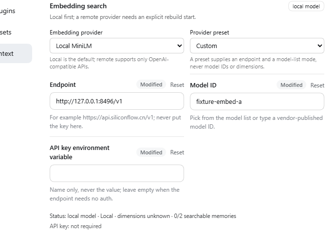

# Magic Context Settings UI contract

> Status: current — host baseline DSH 0.2.2-rc.1. The T21 settings layout and actions were checked in the isolated Web gate recorded in `_bmad-output/initiative-dsh-magic-context/acceptance-windows-dsh-2026-11-17-settings-redesign/` (2026-11-17); the compaction-scope section remains source-checked 2026-11-16 without a new browser gate.

This document is the **current** contract for the Magic Context browser settings
surface. It replaces the settings-card portion of the historical
[`dsh-plugin-config-ui-contract.md`](dsh-plugin-config-ui-contract.md); that older
document remains as a 2026-10 record of the pre-client-half contract and is not a
description of the shipped UI.

## 1. Entry points

The client half (`src/client/index.js`, copied verbatim to `lib/client.js`) registers
**one** React component while the `magic-context-dsh` ConfigForm is served
(`ctx.configForms.whileServed([CFG_NS])`):

| Slot | Purpose | Identity |
|---|---|---|
| `settings.section` | **Settings → Magic Context**, a sibling of the host's "内置插件 / Built-in plugins" navigation item | `id: 'magic-context'`, `order: 30` |

The former `plugins.item` and `plugins.row.config` entries were removed in T21 and
are no longer registered; the old Plugins-page card is not maintained. This is a
breaking change: a host that does not declare `settings.section` has no Magic
Context configuration card at all. The card does not fall back to a second seat or
to a plain-control form.

The single registration declares `locale: 'magic-context'` and the section uses
`label: () => t('title')`, so the navigation label follows the active DSH language.
It is disposed with the `whileServed` effect.

Each mount owns its own drafts. The host footer Save is the only user-visible Save;
the card never renders a second Save, a global Reset or a footer slot.

## 2. Localization contract

The browser half registers one locale namespace (`magic-context`) with `zh` and `en`
dictionaries. The slot renderer passes the namespace-bound `t` to the card as
`props.t`; the card falls back to the shipped translator only outside a slot.

- Every **card-owned** string resolves through `t(...)`: all 35 field labels and hints,
  the five section titles/descriptions, the four summary metrics, the jump row, the status
  strip, the advanced disclosure, the embedding action bar, both confirmation dialogs, the
  `Auto` route captions, the form frame (`unavailable` / `readOnly` / `saveFailed` / `save` /
  `saving` / `Modified` / `Reset` / `Invalid` / `Not a number`), and the effort picker captions.
- Host/provider data stays literal: provider ids, model ids, model names, effort ids,
  effort `name`/`description`, `TTL`, and `token` are not translated.
- `FORM_LABELS` is built by `formLabels(t)` inside the card render. It is not translated
  once at `apply` time, so a language switch updates the form frame without a reload.
- Field copy keys are derived from the field path
  (`settings.field.<path>.label` / `.hint`) by a single helper; `settingsCopyKeys()`
  derives the field list from `FIELDS` and adds the summary/form/route/effort keys. It is
  consumed by `scripts/mc-i18n-check.mjs` and `tests/client-pure.spec.ts`.
- `check:i18n` also keeps its no-hardcoded-Chinese scan, `t('...')` reference scan,
  zh/en key-set parity, and slot `locale` wiring checks.

## 3. Historian reasoning-effort picker

The stored value remains the optional string `historian.reasoningEffort`
(`src/dsh/config.ts`). The UI never changes its type or adds a second store.

The picker is derived from the same single host catalog read used by the route pins
(`remote.session.modelCatalog()`), normalized to:

```js
{ id, name, reasoning: { efforts: [{ id, name?, description? }], defaultEffort? } }
```

Malformed rows, empty ids, duplicate ids, and the `__custom__` sentinel are dropped;
host order is preserved.

| Route/catalog state | Control |
|---|---|
| Pinned provider + model, model advertises efforts | Native select: `Default`, each advertised id in host order, and an always-present `Custom…` sentinel |
| Pinned route, model present but no `reasoning` / empty efforts | Text input plus `Default`; a stored value stays editable |
| Unpinned / `Auto` route | Text input plus `Default`; the hint says pinning provider + model enables the list |
| Provider/model missing from the catalog, or catalog unavailable | Text input plus `Default` (no guessed list) |

Semantics:

- `Default` stages a clear (`{ clear: true }`), which the save path turns into
  `{ op: 'unset', path: ['historian', 'reasoningEffort'] }`. It never writes a made-up
  effort id.
- A listed id writes exactly that string. `Custom…` reveals a text input and stages its
  text; the sentinel is never stored.
- A stored id that is not in the current catalog renders as `Custom (<value>)` and is
  preserved on save unless the user edits or clears it. It is never silently cleared,
  remapped, aliased, or clamped.
- Selecting `Custom…` drops any staged clear/listed draft and keeps the custom input
  open (showing the stored value when one exists, empty otherwise) instead of snapping
  back to `Default`. An explicit `Default` or listed selection closes it.
- The unknown-id hint is shown only when the custom value is non-empty and is not in the
  advertised list; opening `Custom…` on a listed value does not claim it is unknown.
- Changing the pinned provider/model refreshes the options and does not rewrite the
  stored effort. The route staging may clear a model that does not belong to a newly
  chosen provider; the settings gate must save only after both halves are chosen.
- The client does not validate an id against the advertised list: the host/provider stays
  authoritative. An unsupported id fails explicitly with the provider's
  `UNSUPPORTED_REASONING_EFFORT` error; it is not hidden by the UI.

Pure seams (`__diagnostics`), exercised by `tests/client-pure.spec.ts`:

- `reasoningEffortsOf(groups, provider, model)` → `{ kind: 'auto' | 'missing' | 'none' | 'ready', efforts, defaultEffort? }`
- `effortSelectionOf(options, current)` → `{ mode: 'default' | 'value' | 'custom', value }`
- `effortDraftOf({ baseValue, stored, draft, customOpen, options })` →
  `{ mode, value, displayValue, customOpen, cleared }`
- `effortPlanOps(path, draft)` → `{ ops, blocked }`

The card renders from these helpers; the tests exercise the real plan/save shape rather
than a mirrored implementation.

## 4. Save path

- Nothing is written until **Save**. The card stages drafts and posts one
  revision-fenced mutation (`scope.mutate(ops, snapshot.revision)`).
- For `kind: 'effort'`, `plan()` delegates to `effortPlanOps()`: `clear` or blank text →
  `unset`; non-empty trimmed text → `set`. It never blocks a save.
- Untouched fields never materialize into override rows. A stored unknown effort is
  therefore preserved by an unrelated save.
- `Default` must render as selected when the effective draft is a clear, even if the base
  layer holds a value; `effortDraftOf()` marks that state `cleared: true`.
- The native select and text input carry `aria-label`/`htmlFor` associations and are
  disabled when the deployment is read-only.

## 5. Compaction takeover scope

`registerCompactionEngine` only mounts the adapter's root `ctx.compaction` seam. It is a
**flat/headless host** switch, not a general compaction takeover.

- In DSH 0.2.2-rc.1, the Web and Desktop bundles disable the root `compaction-basic` row,
  and every agent preset mounts its own nested `compaction` group with
  `isolate.compaction: true`.
- A profile-patch top-level `compaction-basic` row does not reach a preset's
  `config.plugins`; only overriding the preset row itself reaches that composition, which
  this plugin does not do. The top-level row therefore does not replace a preset engine.
- The switch only takes effect in a flat/headless composition after that composition's
  root `compaction-basic` row is disabled. Web and Desktop users should leave it off.
- The Settings hint carries this limitation, and there is no automatic profile-patch
  writer.

The upstream `dsh-plugin-magic-context` 0.11.2 README shows the same two-row recipe as a
general takeover. That recipe is flat-only and does not work on DSH Web/Desktop; it was
reported upstream as
[wk544863858/dsh-plugin-magic-context#16](https://github.com/wk544863858/dsh-plugin-magic-context/issues/16).

A preset-scoped compaction backend is not available today. The relevant DSH feature
request is the Ideas discussion
[deepseek-ai/deepseek-harness#11127](https://github.com/deepseek-ai/deepseek-harness/discussions/11127);
this fork added its concrete use case and evidence there on 2026-11-16.

## 6. Compatibility and fallback

- The redesigned card requires the `settings.section` slot. A host without it shows no
  Magic Context configuration card; there is no legacy Plugins-page fallback anymore.
- The card also requires `SettingsForm` and `SettingsValueField` from
  `@deepseek-ai/dsh-client-ui-primitives`. Without those primitives it renders the
  localized unavailable notice only: no fields, no second Save and no plain-control
  fallback.
- A shell without `remote.session.modelCatalog()` keeps the route and effort fields on
  plain text; no catalog data is invented.
- The host `SettingsForm` has no footer slot, no `busy` prop, no global Reset and no
  close interception. The card places a text-only status strip above the fixed host
  footer and refuses writes through its own `onSave` guard while a probe or migration
  is in flight; it does not pretend the host Save can be disabled through a busy prop.

## 7. Evidence baseline

- Host: DSH 0.2.2-rc.1 with a real Web client.
- The Web gate installs a local tarball into a **fresh isolated profile**, starts the
  real Web host with a token URL / `--no-open`, and drives Settings through Playwright.
- The T13/T18 gate covered the top-level nav item and its sibling relationship, zh/en
  switching, a pinned `deepseek-official/deepseek-flash` route, the advertised
  `off/low/high/max` list (no `medium`), save/reload of a listed id, the always-available
  Custom path, unknown-value preservation, provider/model change, and Default/clear in the
  resolved config. T21 replaces the layout and adds one new browser gate for the summary,
  five sections, advanced disclosure, dirty action labels, confirmations and rollback
  ordering; its evidence is stored with the T21 acceptance directory.
- Headless DSH has no Settings UI; pure tests and the headless runtime smoke are
  supplementary, not a substitute for the browser gate.

## 8. Remote embedding fields, credentials and routes (T20/T24)

The `embedding` block is a top-level, **user-level** Settings block. It is not
project-scoped: a project must not redirect the endpoint or the API-key
environment name. The current host does not expose a project/tier source, so
that rule is a design boundary rather than an enforced runtime check yet.



Fields: provider (`local`/`openai-compatible`/`off`), preset
(`siliconflow`/`custom`), endpoint, auth header, model, API-key credential
reference name, API key (write-only), dimensions override, query instruction, document prefix,
background timeout, query timeout and batch size.

- Model IDs come from `GET /mc-embedding/models` (or manual entry), never from a
  compiled model table. Dimensions come from `POST /mc-embedding/probe` and are
  cached per endpoint/model/override/key-presence.
- `POST /mc-embedding/rebuild?action=start|pause|resume|disarm` manages the
  target-space rebuild state. `disarm` clears state only; it never writes
  config.
- Rollback stages `provider = local` and uses the ordinary revision-fenced
  Save. No route writes profile config.
- POST routes require JSON content type and a matching Origin/Host when an
  Origin is present; they return JSON errors and never return a key or provider
  body.
- `embedding.apiKeyEnv` is the credential reference (`role('credential-ref')`);
  `embedding.apiKey` is a write-only secret (`role('secret')`). The runtime
  resolves literal `apiKey` → host credential store under `apiKeyEnv` →
  environment. The schema default reference is `SILICONFLOW_API_KEY`. An empty
  reference is **unset**: on the SiliconFlow preset it still falls back to the
  default environment variable, while on a custom preset it means no auth
  (the desktop card saves an explicit empty string rather than unsetting it).
  dsh-go hides `role('credential-ref')` fields, so the native form is designed
  to bind the secret to the saved reference or that default; a different
  reference must be saved on desktop first. dsh-go 1.1.0's bridge does not yet
  return `credentialRef`, so its native input currently renders unbound and
  disabled ([issue #1493](https://github.com/ccch1mneyyy/dsh-Go/issues/1493)).
- The desktop card's secret row is bound to the **saved** reference. It calls
  `remote.credentials.set(ref, value)` / `unset(ref)`, never
  `configForms.mutate`; it clears the input after save, shows only
  configured/unconfigured and the source, and is disabled while the reference is
  dirty, empty, malformed, the form is read-only, or the host exposes no
  credential store. The environment fallback remains available in those cases.
  Android's native form uses the same schema: the sibling
  `role('credential-ref')` field names the credential, and the host's
  `SecretFieldTile` is designed to call its credential store. No Flutter change
  is required, but the 1.1.0 bridge gap above must be fixed before the native
  input can be enabled.
- The client shows only key presence and source, warns about sending memory text
  to the endpoint, and labels plain HTTP on non-local endpoints. Load models and
  Test remain available while the form is dirty; they first run the ordinary
  revision-fenced Save and only then call the route. Both are disabled while a
  rebuild is running or paused. Start and Rollback require a clean form.

## 9. Settings layout and actions (T21)

One `settings.section` card, rendered as a single page:

- Summary strip: reclaim policy (`execute/force`), Historian (`on/off` + effort),
  vector space (local/off/remote + model), rebuild (state + coverage). Values come
  only from the config snapshot and `/mc-embedding/status`; unknown is `—`, never 0.
- Jump row: scrolls to one of five sections without remounting or dropping drafts.
- Sections: 常规, 历史摘要, 日志, 向量检索, 维护与诊断. Every one of the 35
  `FIELDS` belongs to exactly one section and one placement (common/advanced);
  `FIELDS` remains the only inventory.
- Advanced disclosures: General budgets, Historian limits, Journal mirror,
  Embedding auth/dimensions/query instruction/document prefix/timeouts/batch size.
- Status strip: text only, last child above the fixed host footer: saved, unsaved
  count, invalid count, saving, working (probe/load/test), or migrating-busy. It
  is not a footer slot and it renders no Save/Reset.
- No second Save, no global Reset, no `busy` prop and no close interception. The
  card refuses writes through its `onSave` guard while a probe or migration is in
  flight; closing Settings drops drafts.

Embedding actions:

- Load models requires a resolvable endpoint (saved or preset default); Test
  requires a saved model and a resolvable endpoint.
- Dirty Load/Test are labelled `保存并加载模型` / `保存并测试`, run one existing
  revision-fenced Save, and perform the action only if that Save is accepted.
- Start requires a clean form, a saved model, a probed dimension, at least one
  searchable memory (`coverage.total > 0`), an available API key when one is
  configured, enabled memory and no `dimensions-unsupported` failure. It
  confirms the `coverage.missing` count and possible quota spend first.
- Rollback confirms, stages `provider = local`, saves, and calls `disarm` only
  after the Save is accepted. A failed Save leaves the remote target armed.
- Pause/Resume are server actions and do not depend on draft state.
- Status polls every 2s while migrating, otherwise every 15s; it stops while
  paused/off/error or hidden, keeps the 15s refresh while remote-ready, and
  deduplicates in-flight reads.

## 10. Boundaries

- No runtime effort mapping, clamping, validation, or fallback aliasing.
- The only model-list/probe/rebuild RPCs are the plugin-owned `/mc-embedding`
  routes above; there is no host catalog write. The only host remote namespace
  used for key storage is `remote.credentials`; secret values never cross the
  settings config editor or the `/mc-embedding` status payload.
- No vendor-specific embedding adapter or SDK. Remote support is the standard
  OpenAI embeddings shape only.
- No host schema, database, tool, command, or release change in this contract;
  the plugin declares its own volatile `embedding` config block and uses only
  its own `/mc-embedding` routes.
- Only an isolated profile may be used for the Web gate; the daily DSH profile and its
  data are not touched.
